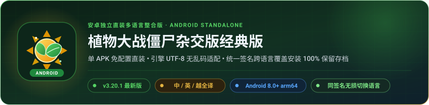
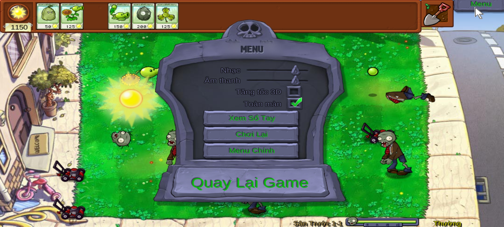
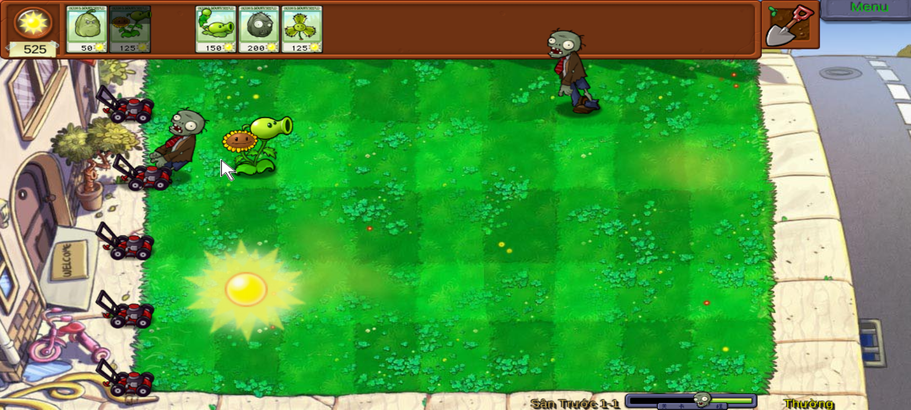

  

  
  
  
  

  &nbsp;&nbsp;
  &nbsp;&nbsp;
  

  🌐 <b>Switch Language / Đổi ngôn ngữ:</b> Click <b><a href="README.md">[EN] English</a></b> for English • Bấm <b><a href="README.vi.md">[VI] Bản Việt Hóa</a></b> để xem Tiếng Việt

  <a href="#downloads"><b>📥 下载专区</b></a> &nbsp;•&nbsp;
  <a href="#install"><b>🔄 安装与语言切换</b></a> &nbsp;•&nbsp;
  <a href="#highlights"><b>✨ 技术特性</b></a> &nbsp;•&nbsp;
  <a href="#screenshots"><b>📸 真机截图</b></a> &nbsp;•&nbsp;
  <a href="#guides"><b>📚 指南与排查</b></a> &nbsp;•&nbsp;
  <a href="#credits"><b>👥 致谢名单</b></a>

---

## 📥 独立整合 APK 下载 — `v3.20.1`

> [!TIP]
> **单包直装 · 统一签名 100% 无损保留存档：** **`[CN] 中文原版`**、**`[VI] 越化版`**、**`[EN] 英文版`** 全部采用独立包名 `com.pvzh.cls` 与同一套项目官方 **Release Keystore** 封装。无需另行安装模拟器或导入容器，三语之间只需**直接覆盖安装（切勿卸载）**即可随时互切语言并 100% 保留通关存档！

完整更新日志与校验码：**[GitHub Release `v3.20.1`](https://github.com/Heagon/pvz-hybrid-classic-android/releases/tag/v3.20.1)**

| 语言版本 | 文件大小 | 版本说明 | 直接下载 |
| :--- | :---: | :--- | :---: |
| **`[CN]` 中文原版 (Raw)** | `389.4 MiB` (`408.4 MB`) | 完整保留 **潜艇伟伟迷** v3.20.1 原版游戏文件与字体，打包为免配置单包 APK，采用统一签名支持与英/越版自由互切 |  |
| **`[EN]` English (英文版)** | `390.0 MiB` (`408.9 MB`) | 完整英文本地化（3,309 条属性词条 + 985 条 EXE 独立词条 / 1,344 处引用、121 张英文重绘贴图、`gdi42.dll` UTF-8 补丁与安卓真机校验） |  |
| **`[VI]` Bản Việt Hóa (越化版)** | `390.0 MiB` (`409.0 MB`) | 完整越南语本地化（3,309 条属性词条 + 985 条 EXE 词条、121 张越化贴图、6 套融合声调 `.ttf` 字库 + `PvZ2-VH Bold` 标题字体） |  |

<b>🔐 APK 校验信息与 SHA-256 哈希表</b>

- **应用包名：** `com.pvzh.cls` · **版本号：** `3.20.1` (`versionCode: 3201`)
- **统一签名证书 SHA-256：** `0240760843400889e49e0030ea741eace8e6e97d64b47c560d609438943339f2`

| 文件名 | 精确字节数 | SHA-256 |
| :--- | :---: | :--- |
| `PvZ-Hybrid-Classic-3.20.1-Chinese-Raw.apk` | `408,361,181` | `09344c5b544faaed2eb0738e543093aadd91096fa6b1b651f9f0de7c6c94ef71` |
| `PvZ-Hybrid-Classic-3.20.1-English.apk` | `408,930,525` | `32b37bbbb1bb3d46c72c42092f12e04e9da951edb3915462499cc6e71acbab3c` |
| `PvZ-Hybrid-Classic-3.20.1-Vietnamese.apk` | `409,012,445` | `e529884d03b514641b14576efdc7c803b4f764868fc07ea11bbcc525c1f60feb` |

---

## 🔄 三步直装与无损切换语言

1. **下载安装包：** 从上方表格挑选任意语言版本（需 **Android 8.0+ / `arm64-v8a`**，预留约 1.8 GB 存储空间）。
2. **直接安装或覆盖升级：** 打开 APK 点击 **安装 / 更新**（跨语言切换时**切勿卸载旧版**）。
3. **首次等待 ~20–45 秒后畅玩：** 内置 `PvZBootstrapActivity` 自动释放环境与游戏资源并预建 `Player` 存档，全屏直入《植物大战僵尸杂交版经典版 v3.20.1》！

### 📚 文档指南与工具链

| 文档导航 | 内容概要 |
| :--- | :--- |
| 📖 **[安装指南与常见问题 (`docs/INSTALL.md`)](docs/INSTALL.md#cn-简体中文)** | 设备要求、安全提示说明、手机返回键呼出 `WASD`/`Space` 虚拟键及渲染调节。 |
| 🔄 **[无损更新与切换原理 (`docs/UPDATE.md`)](docs/UPDATE.md#cn-简体中文)** | `pvz_edition.txt` 差异替换 `pvz_game/` 并完好保留 `yourdata/` 存档的机制。 |
| 💾 **[PC 端存档导入教程 (`docs/MIGRATION.md`)](docs/MIGRATION.md#cn-简体中文)** | 免 Root 将 Windows `C:\ProgramData\PopCap Games\PlantsVsZombies\pvzHE\yourdata\` 导入本 APK。 |
| 🛠️ **[构建与本地化脚本 (`tools/README.md`)](tools/README.md)** | 公开 `gdi42.dll` UTF-8 补丁、EXE 重定位、贴图重绘与 `.tzst` 打包脚本。 |
| 👥 **[完整致谢名单 (`CREDITS.md`)](CREDITS.md#cn-简体中文)** | 致敬原作者、社区贡献者及开源工具库。 |

---

## ✨ 核心技术亮点

- **真正零配置单包体验：** 独立封装运行容器于 `com.pvzh.cls` 内，免 Root、无需手动导入数据包或单独配置 Winlator，且不与其他软件冲突。
- **原生 `1080x600` 移动宽屏满屏与单点即响：** 默认启用原生 `1080x600` 宽屏并全面屏铺满手机屏幕（无黑边、不裁剪右侧菜单），修复 `TouchpadView` 独立 X/Y 触控缩放并在 `ACTION_DOWN` 时同步移动指针与 60 ms 点击保持，大幅提升首触响应速度。
- **加载与帧率优化：** 启用激进后台服务精简 (`startupSelection=2`)、`WineD3D` `csmt=3`、`strict_shader_math=0`、`mesa_glthread=true`、关闭 `WaitForVSync` 并锁定 `Is3D=0` 正向色彩渲染（热启动约 4.7 秒拉起游戏进程）。
- **底层 UTF-8 与全字库融合：** 修改 `gdi42.dll` 4 处 `MultiByteToWideChar`（`CP936` → `CP_UTF8`），并将完整拉丁扩展及越南语声调字形注入全部 6 套 `.ttf` 字体。
- **双语深度本地化：**
  - **3,309 / 3,309** 条 `properties/*.txt` 全覆盖（图鉴、关卡、智慧树、商店、成就）。
  - **985 条独立 / 1,344 处** `PlantsVsZombies.exe` 硬编码词条重定位，同步更新 **73 处 `std::string(ptr, len)` 长度压栈指令**（彻底消除 `□□` 乱码与截断）及主菜单版本标识。
  - **121 张 / 语言** 界面贴图重绘（主菜单木牌、模式墓碑、18 个章节横幅、图鉴与商店按钮）。

---

## 📸 安卓真机实测截图（EN / VI 对比）

以下截图全部采集自实体 `arm64-v8a` 安卓手机（左：**`[EN]` 英文版** · 右：**`[VI]` 越化版**）：

| `[EN]` 英文版主菜单 | `[VI]` 越化版主菜单 |
| :---: | :---: |
|  |  |
| **`[EN]` 选卡界面** | **`[VI]` 选卡界面** |
|  |  |
| **`[EN]` 植物图鉴** | **`[VI]` 植物图鉴** |
|  |  |
| **`[EN]` 局内暂停菜单** | **`[VI]` 局内暂停菜单** |
|  |  |

<b>🖼️ 查看规则弹窗与草坪战斗截图（EN / VI）</b>

 

| `[EN]` Player Rules | `[VI]` Nội Quy &amp; Khởi Động |
| :---: | :---: |
|  |  |
| **`[EN]` 前院 1-1 实机** | **`[VI]` 前院 1-1 实机** |
|  |  |

---

## 👥 致谢名单 (Credits)

| 模块与角色 | 作者与贡献成员 | 来源说明 |
| :--- | :--- | :--- |
| **原版模组制作** 《植物大战僵尸杂交版经典版》 | • **潜艇伟伟迷** — 模组创作、设计与主程序 • **原版片头特别鸣谢：** 小小咩MS、AXH弦、一只吴铭仕哒、沉默寡言白河愁 | *PvZ 杂交版经典版 v3.20.1* |
| **英/越本地化、UTF-8 引擎补丁与安卓单包整合** | • **Heagon** — 3,309 条属性词条 + 985 条 EXE 词条、121 张贴图重绘/语种、`gdi42.dll` UTF-8 改造、6 字库合并、`WineD3D` GL + `GLXExtension` 正向修复、`com.pvzh.cls` 无损独立打包 | [GitHub 仓库主页](https://github.com/Heagon/pvz-hybrid-classic-android) |
| **开源构建组件** | [Winlator](https://github.com/brunodev85/winlator) (`Box64` · `Wine`), [fontTools](https://github.com/fonttools/fonttools), [Pillow](https://python-pillow.org/), [Liberation Fonts](https://github.com/liberationfonts/liberation-fonts), [Apktool](https://apktool.org/), [uber-apk-signer](https://github.com/patrickfav/uber-apk-signer), [Zstandard](https://github.com/facebook/zstd) | 详见 [CREDITS.md](CREDITS.md#cn-简体中文) |

---

## ⚖️ 版权与非商业免责声明

- 《植物大战僵尸》（*Plants vs. Zombies*）商标及原作版权归 **Electronic Arts Inc. (EA) / PopCap Games** 所有。
- 《植物大战僵尸杂交版经典版》一切模组版权归原作者**潜艇伟伟迷**所有。
- 本仓库为**100% 免费、无广告、非商业**社区移植与本地化作品，严禁任何倒卖或付费二次分发。
