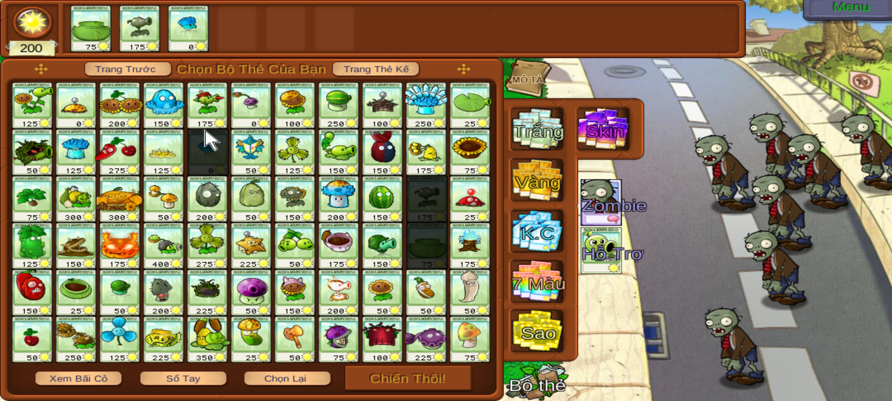
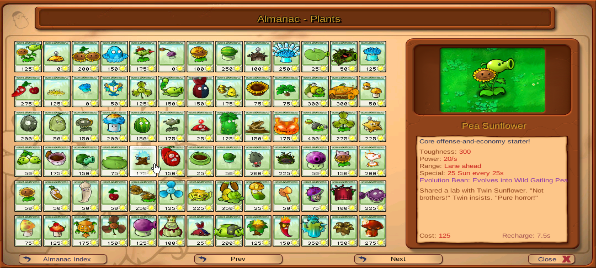
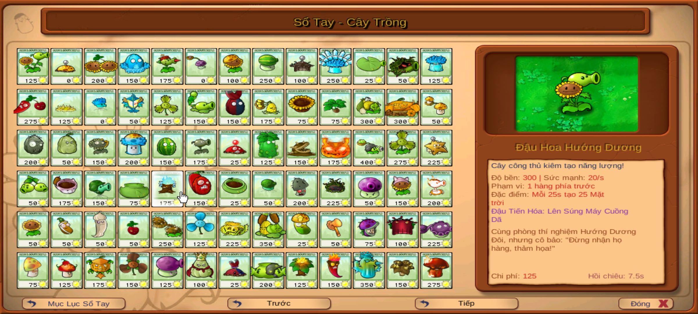
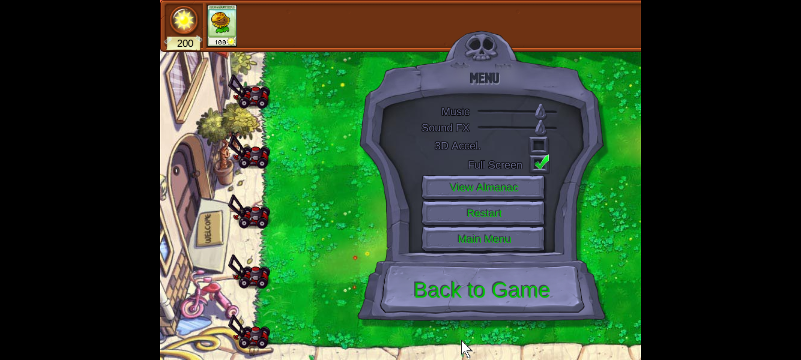
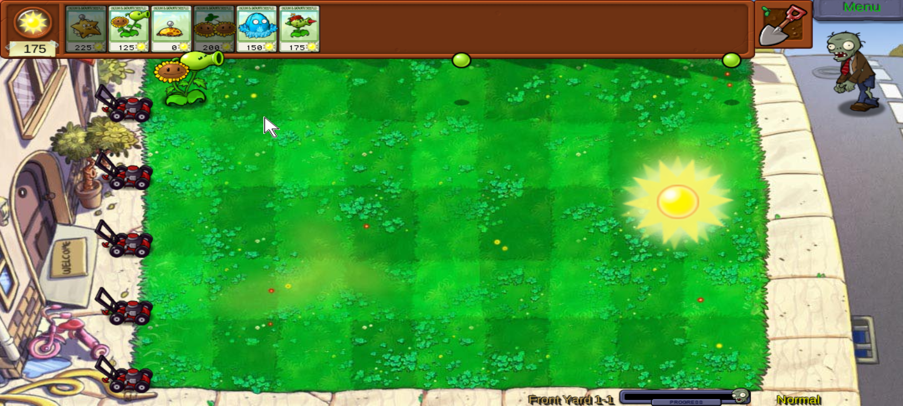

  

  
  
  
  
  

  &nbsp;&nbsp;
  &nbsp;&nbsp;
  

  🌐 <b>Switch Language / Đổi ngôn ngữ:</b> Click <b><a href="README.md">[EN] English</a></b> for English • Bấm <b><a href="README.vi.md">[VI] Bản Việt Hóa</a></b> để xem Tiếng Việt

  <a href="#downloads"><b>📥 下载专区</b></a> &nbsp;•&nbsp;
  <a href="#install"><b>🔄 安装与语言切换</b></a> &nbsp;•&nbsp;
  <a href="#highlights"><b>✨ 技术特性</b></a> &nbsp;•&nbsp;
  <a href="#screenshots"><b>📸 真机截图</b></a> &nbsp;•&nbsp;
  <a href="#guides"><b>📚 指南与排查</b></a> &nbsp;•&nbsp;
  <a href="#credits"><b>👥 致谢名单</b></a>

---

## 📥 独立整合 APK 下载 — `v3.20.1` (构建 `B.0.2` · 最新)

> [!TIP]
> **独立构建编号 `B.x.y` · 统一签名 100% 无损保留存档：** 每次发布均拥有独立文件名与 GitHub Release 页面（`PvZ-Hybrid-Classic-3.20.1-<语言>-B.x.y.apk`），方便区分新旧版本、查阅修复记录并支持随时无损回退。三语版本共享包名 `com.pvzh.cls` 与官方 **Release Keystore**——只需**直接覆盖安装（切勿卸载）**即可升级、切换语言或回退且 100% 保留存档！

完整更新日志与修复清单：**[GitHub Release `v3.20.1-B.0.2`](https://github.com/Heagon/pvz-hybrid-classic-android/releases/tag/v3.20.1-B.0.2)** · 构建历史与旧版归档：**[`CHANGELOG.md`](CHANGELOG.md)**（[基线版 `v3.20.1-B.0.1`](https://github.com/Heagon/pvz-hybrid-classic-android/releases/tag/v3.20.1-B.0.1)）

| 语言版本 | 文件大小 | 版本说明 | 直接下载 |
| :--- | :---: | :--- | :---: |
| **`[CN]` 中文原版 (`B.0.2`)** | `389.47 MiB` (`408.4 MB`) | 保留 **[潜艇伟伟迷](https://space.bilibili.com/97213827)** v3.20.1 原版内容与字体，内置 **实时 `30/60/90/120 FPS` 切换 + `50.5–89.2 FPS` 非战斗帧率 + `OPT 8–13` + `PAD` 工具栏 + 菜单/我是僵尸/查看草坪/防崩溃补丁** |  |
| **`[EN]` English (`B.0.2`)** | `387.72 MiB` (`406.6 MB`) | 完整英文本地化（3,309 属性词条 + 437 图鉴重排、1,038 EXE 词条 / 1,421 引用、171 张贴图、**实时 `30/60/90/120 FPS` + `OPT 8–13` + `PAD` 工具栏 + 全部修复**） |  |
| **`[VI]` Bản Việt Hóa (`B.0.2`)** | `387.88 MiB` (`406.7 MB`) | 完整越南语本地化（3,309 属性词条 + 437 图鉴重排、1,038 EXE 词条 / 1,421 引用、171 张越化贴图、6 套声调 `.ttf` 字库、**实时 `30/60/90/120 FPS` + `OPT 8–13` + `PAD` 工具栏 + 全部修复**） |  |

<b>🔐 APK 校验信息与 SHA-256 哈希表 (`v3.20.1-B.0.2`)</b>

- **应用包名：** `com.pvzh.cls` · **版本号：** `3.20.1` (`versionCode: 3201`) · **构建编号：** `B.0.2`
- **统一签名证书 SHA-256：** `0240760843400889e49e0030ea741eace8e6e97d64b47c560d609438943339f2`

| 文件名 | 精确字节数 | SHA-256 |
| :--- | :---: | :--- |
| `PvZ-Hybrid-Classic-3.20.1-Chinese-Raw-B.0.2.apk` | `408,393,944` | `799db80d71d0441073a26cc3a8da03accb87332a6f41e1d9cc70b15b079f110e` |
| `PvZ-Hybrid-Classic-3.20.1-English-B.0.2.apk` | `406,554,840` | `c299cf884bc665fa244455c9a01ea029f237676f8f5b08c80be987d80b0f8098` |
| `PvZ-Hybrid-Classic-3.20.1-Vietnamese-B.0.2.apk` | `406,718,680` | `f3c00fc4db478ce06c3872cc30ca0b910d5dbf16b53966b030da6aef1c0cedb5` |

---

## 🔄 三步直装与无损切换语言

1. **下载安装包：** 从上方表格挑选任意语言版本（需 **Android 8.0+ / `arm64-v8a`**，预留约 1.8 GB 存储空间）。
2. **直接安装或覆盖升级：** 打开 APK 点击 **安装 / 更新**（跨语言切换时**切勿卸载旧版**）。
3. **首次等待 ~20–45 秒后畅玩：** 内置 `PvZBootstrapActivity` 自动释放环境与游戏资源并预建 `Player` 存档，全屏直入《植物大战僵尸杂交版经典版 v3.20.1》！

### 📚 文档指南与工具链

| 文档导航 | 内容概要 |
| :--- | :--- |
| 📖 **[安装指南与常见问题 (`docs/INSTALL.md`)](docs/INSTALL.md#cn-简体中文)** | 设备要求、安全提示说明、手机返回键呼出 `WASD`/`Space` 虚拟键与 `PAD` 工具栏说明。 |
| 🔄 **[无损更新、回退与语言切换 (`docs/UPDATE.md`)](docs/UPDATE.md#cn-简体中文)** | `pvz_edition.txt` (`B.x.y`) 差异替换 `pvz_game/` 并完好保留 `yourdata/` 存档的原理。 |
| 📋 **[构建历史与修复日志 (`CHANGELOG.md`)](CHANGELOG.md)** | 完整记录每个 `B.x.y` 版本（`B.0.1`、`B.0.2`...）的修复明细与旧版回退链接。 |
| 💾 **[PC 端存档导入教程 (`docs/MIGRATION.md`)](docs/MIGRATION.md#cn-简体中文)** | 免 Root 将 Windows `C:\ProgramData\PopCap Games\PlantsVsZombies\pvzHE\yourdata\` 导入本 APK。 |
| 🛠️ **[构建与本地化脚本 (`tools/README.md`)](tools/README.md)** | 公开 `gdi42.dll` UTF-8 + 字形图集、`OPT 1–13`、稳定性补丁、贴图重绘与 `.tzst` 打包脚本。 |
| 👥 **[完整致谢与官方来源 (`CREDITS.md`)](CREDITS.md#cn-简体中文)** | 致敬原作者（**潜艇伟伟迷**）、合作者、EA/PopCap 及开源工具库。 |

---

## ✨ 核心技术亮点 (`B.0.2`)

- **零配置单包体验、`PAD` 悬浮控键与彻底退出：** 独立封装运行容器于 `com.pvzh.cls` 内，免 Root、无需手动导入数据包；内置可拖动 **`PAD`** 工具栏（实时切换 **`30 / 60 / 90 / 120 FPS`**、底部快捷热键条、英雄方向键、拖拽、透明度、虚拟键盘、菜单），退出游戏时彻底清理 Wine 进程不自启。
- **实时 `30 / 60 / 90 / 120 FPS` + 非战斗全场景 `50.5–89.2 FPS` + 精准 `100.00 Hz` 原速逻辑 (`OPT 1–13` + `gdi42` O(1) 字形图集)：** 结合 **`VirGL`** + **`WineD3D` GL (`csmt=0`、FBO)**、Box64 快速 Dynarec、`detectBigCoreAffinity()` 以及 13 项二进制引擎优化（单四边形选卡缓存图集、12 页通用精灵图集 + `3072` 顶点合批、`HasSeedType` O(1) 缓存、遮挡剔除与零系统调用 `fps_cap.bin` 控帧）。在 **TECNO LG8n (Helio G99, 90 Hz)** 实测：**所有非战斗界面均达 `50.5–89.2 FPS`**（五大生存选卡 **`62.6–67.1 FPS`**），`30/60/120 FPS` 全程保持严格 **`100.00 Hz` (`-10s/10.0s`)** 游戏逻辑速度。
- **多项实机稳定性与交互修复 (`patch_exe_fixes.py` + `ViewLawn`)：** 修复单点 `Menu` 按钮无响应（含“我是僵尸”）、修复“查看草坪”软锁、修复“我是僵尸”无限免费放僵尸、修复长局 `LAA (>2 GB)` 指针符号崩溃、新增 30+ 英雄与动画防崩溃保护、图鉴 O(1) 查找表与设置弹窗精简。
- **底层 UTF-8、6 字库融合与双语精翻：** `gdi42.dll` 4 处 `CP936` → `CP_UTF8` 改造，3,309 条属性词条 + 1,038 条 EXE 词条（1,421 处引用）+ 171 张/语种界面贴图重绘。

---

## 📸 安卓真机实测截图（EN / VI 对比）

以下截图全部采集自实体 `arm64-v8a` 安卓手机（左：**`[EN]` 英文版** · 右：**`[VI]` 越化版**）：

| `[EN]` 英文版主菜单 | `[VI]` 越化版主菜单 |
| :---: | :---: |
|  |  |
| **`[EN]` 选卡界面** | **`[VI]` 选卡界面** |
|  |  |
| **`[EN]` 植物图鉴** | **`[VI]` 植物图鉴** |
|  |  |
| **`[EN]` 局内暂停菜单** | **`[VI]` 局内暂停菜单** |
|  |  |

<b>🖼️ 查看规则弹窗与草坪战斗截图（EN / VI）</b>

 

| `[EN]` Player Rules | `[VI]` Nội Quy &amp; Khởi Động |
| :---: | :---: |
|  |  |
| **`[EN]` 前院 1-1 实机** | **`[VI]` 前院 1-1 实机** |
|  |  |

---

## 👥 致谢名单与官方来源 (Credits)

完整官方版权与致谢页：**[`CREDITS.md`](CREDITS.md#cn-简体中文)**

| 模块与角色 | 作者与贡献成员 | 官方链接 |
| :--- | :--- | :--- |
| **原版模组制作** 《植物大战僵尸杂交版经典版》 | • **潜艇伟伟迷** — 模组创作、设计与主程序 • **原版片头特别鸣谢：** 小小咩MS、AXH弦、一只吴铭仕哒、沉默寡言白河愁 | [Bilibili 官方主页](https://space.bilibili.com/97213827) · [官方网站 (`pvzhe.com`)](https://pvzhe.com) |
| **原作版权** | • **Electronic Arts Inc. (EA) / PopCap Games** — 《植物大战僵尸》原版商标与版权 | [CREDITS.md](CREDITS.md#cn-简体中文) |
| **英/越本地化、性能优化与安卓单包整合** | • **Heagon** — 3,309 属性词条 + 1,038 EXE 词条（1,421 处引用）、171 张贴图/语种、`gdi42.dll` UTF-8 + 字形图集、6 字库合并、`OPT 1–13` (`30/60/90/120 FPS` + `100 Hz`)、稳定性修复、`PAD` 工具栏与 `com.pvzh.cls` 独立打包 | [GitHub 仓库主页](https://github.com/Heagon/pvz-hybrid-classic-android) |
| **开源构建组件** | [Winlator](https://github.com/brunodev85/winlator) (`Box64` · `Wine`), [MinGW-w64 / w64devkit](https://github.com/skeeto/w64devkit), [fontTools](https://github.com/fonttools/fonttools), [Pillow](https://python-pillow.org/), [Liberation Fonts](https://github.com/liberationfonts/liberation-fonts), [Apktool](https://apktool.org/), [uber-apk-signer](https://github.com/patrickfav/uber-apk-signer), [Zstandard](https://github.com/facebook/zstd) | 详见 [CREDITS.md](CREDITS.md#cn-简体中文) |

---

## ⚖️ 版权与非商业免责声明

- 《植物大战僵尸》（*Plants vs. Zombies*）商标及原作版权归 **Electronic Arts Inc. (EA) / PopCap Games** 所有。
- 《植物大战僵尸杂交版经典版》一切模组版权归原作者**潜艇伟伟迷**所有。
- 本仓库为**100% 免费、无广告、非商业**社区移植与本地化作品，严禁任何倒卖或付费二次分发。
