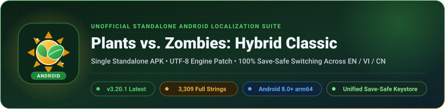
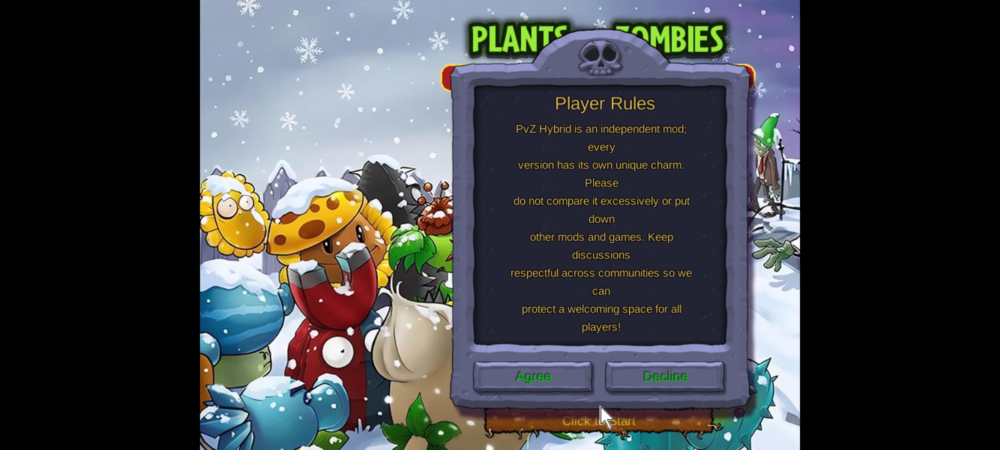
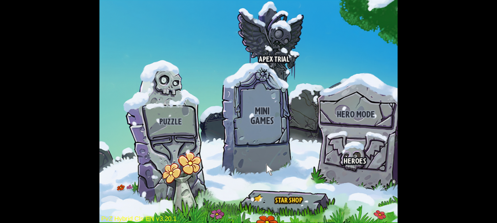
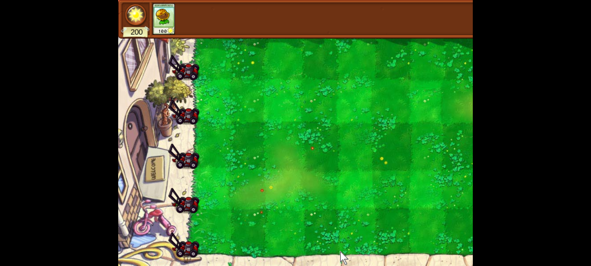
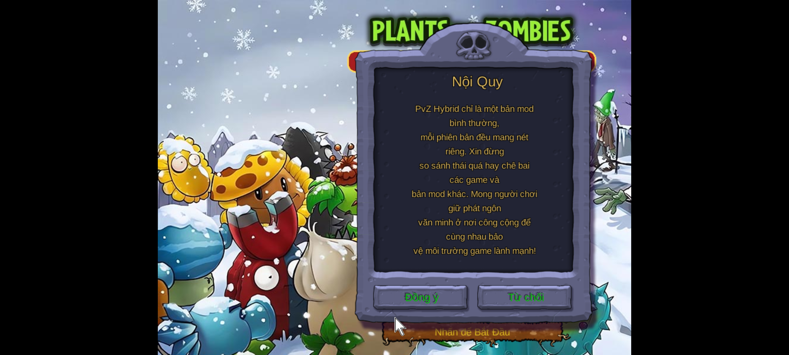
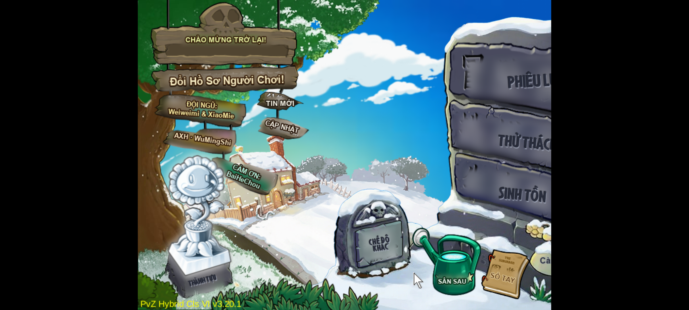
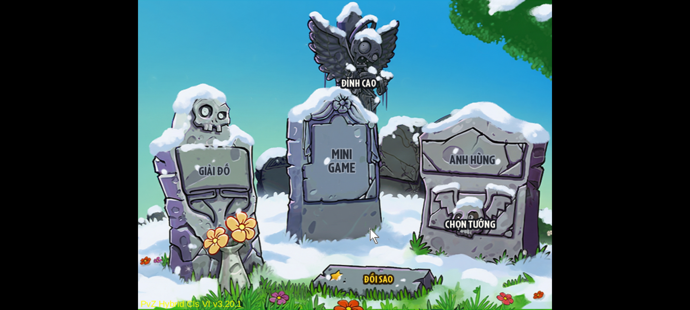
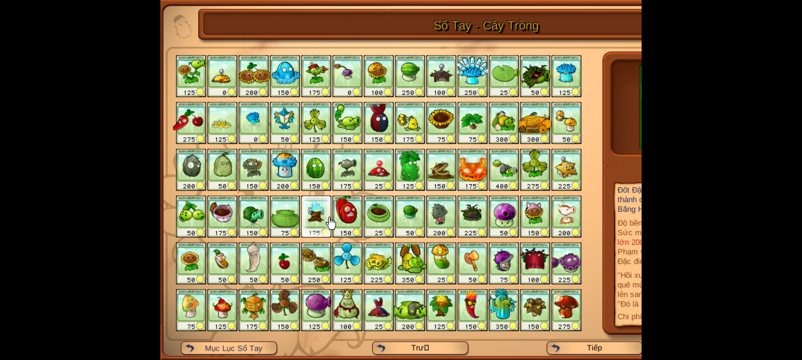
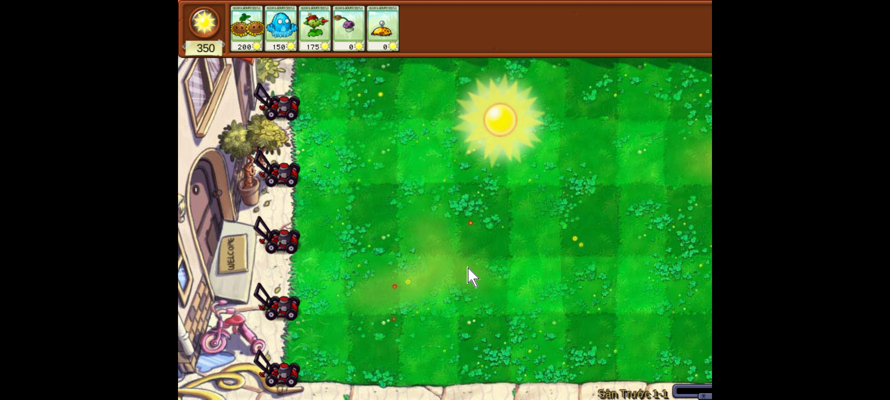
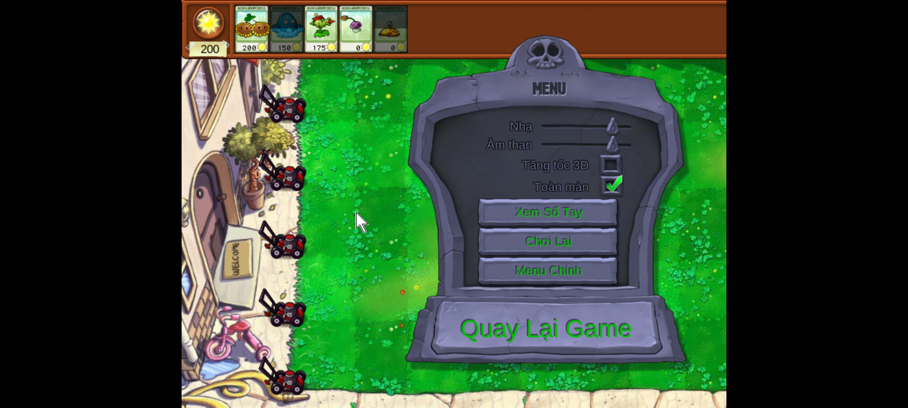

  

  
  
  
  

  &nbsp;&nbsp;
  &nbsp;&nbsp;
  

  🌐 <b>Đổi ngôn ngữ trang / 切换页面语言:</b> Bấm <b><a href="README.vi.md">[VI] Bản Việt Hóa</a></b> để xem Tiếng Việt • 点击 <b><a href="README.cn.md">[CN] 简体中文</a></b> 查看中文说明

  <a href="#downloads"><b>📥 Downloads</b></a> &nbsp;•&nbsp;
  <a href="#install"><b>🔄 Install &amp; Switch Language</b></a> &nbsp;•&nbsp;
  <a href="#highlights"><b>✨ Highlights</b></a> &nbsp;•&nbsp;
  <a href="#screenshots"><b>📸 Screenshots</b></a> &nbsp;•&nbsp;
  <a href="#guides"><b>📚 Guides &amp; FAQ</b></a> &nbsp;•&nbsp;
  <a href="#credits"><b>👥 Credits</b></a>

---

## 📥 APK Downloads — `v3.20.1`

> [!TIP]
> **100% Save-Preserving Standalone APKs:** All three editions (**`[EN] English`**, **`[VI] Bản Việt Hóa`**, and **`[CN] Chinese Raw`**) share package ID `com.pvzh.cls` and the unified **Release Keystore**. No separate emulator, external OBB, or container import needed — just **install directly over your existing app (Update, never uninstall)** to switch languages anytime with 100% of your progress intact!

Full release notes & checksums: **[GitHub Release `v3.20.1`](https://github.com/Heagon/pvz-hybrid-classic-android/releases/tag/v3.20.1)**

| Edition | Size | Summary | Direct Download |
| :--- | :---: | :--- | :---: |
| **`[EN]` English** | `390.0 MiB` (`408.9 MB`) | Complete English build (3,309 property strings, 983 EXE strings / 1,342 binary refs, 121 localized UI textures, UTF-8 engine patch, hardware-verified on Android) |  |
| **`[VI]` Bản Việt Hóa** | `390.0 MiB` (`409.0 MB`) | Complete accented Vietnamese build (3,309 property strings, 983 EXE strings, 121 localized VI UI textures, 6 merged Unicode `.ttf` fonts + `PvZ2-VH Bold`) |  |
| **`[CN]` 中文原版 (Raw)** | `389.4 MiB` (`408.4 MB`) | Untouched original Chinese v3.20.1 by **潜艇伟伟迷**, bundled standalone and signed with the same unified keystore for lossless switching |  |

<b>🔐 APK Verification &amp; SHA-256 Checksums</b>

- **Package Name:** `com.pvzh.cls` · **Version:** `3.20.1` (`versionCode: 3201`)
- **Signing Certificate SHA-256:** `0240760843400889e49e0030ea741eace8e6e97d64b47c560d609438943339f2`

| File | Exact Bytes | SHA-256 |
| :--- | :---: | :--- |
| `PvZ-Hybrid-Classic-3.20.1-English.apk` | `408,930,525` | `cb6c80a8a7b99b97c7dff908f1ceae90a2a47d853c8c6b8322359d89bcda7845` |
| `PvZ-Hybrid-Classic-3.20.1-Vietnamese.apk` | `408,967,389` | `57ba7050979f1753e04dc229f78275a377bd07106e91461f801214f19c51fb38` |
| `PvZ-Hybrid-Classic-3.20.1-Chinese-Raw.apk` | `408,361,181` | `198d6298405f69e536475b65bb85c9c89e88a55283e4162baaac933e00264ec8` |

---

## 🔄 3-Step Installation &amp; Language Switching

1. **Download APK:** Grab **`[EN]`**, **`[VI]`**, or **`[CN]`** from the table above on any **Android 8.0+ (`arm64-v8a`)** device with ~1.8 GB free space.
2. **Install / Update in Place:** Open the APK and tap **Install** (or **Update** when switching between `[EN]` / `[VI]` / `[CN]` — **never uninstall**).
3. **Wait ~20–45s on First Launch &amp; Play:** `PvZBootstrapActivity` automatically unpacks the embedded runtime and game payload, seeds a default `"Player"` profile, and launches *PvZ Hybrid Classic v3.20.1* fullscreen!

### 📚 Guides, Tooling &amp; Documentation

| Guide | What It Covers |
| :--- | :--- |
| 📖 **[Installation &amp; Troubleshooting (`docs/INSTALL.md`)](docs/INSTALL.md)** | System requirements, Play Protect notice, touch &amp; Back-button virtual keyboard (`WASD`/`Space`), and graphics tips. |
| 🔄 **[Safe Updates &amp; Language Switching (`docs/UPDATE.md`)](docs/UPDATE.md)** | Why `pvz_edition.txt` swaps `pvz_game/` cleanly on in-place updates while keeping `yourdata/` saves 100% untouched. |
| 💾 **[PC Save Backup &amp; Migration (`docs/MIGRATION.md`)](docs/MIGRATION.md)** | Step-by-step guide to copy Windows PC saves (`C:\ProgramData\PopCap Games\PlantsVsZombies\pvzHE\yourdata\`) into Android without root. |
| 🛠️ **[Build &amp; Patch Pipeline (`tools/README.md`)](tools/README.md)** | Open-source Python scripts (`gdi42.dll` UTF-8 shim, EXE string relocation, texture localization, `.tzst` &amp; APK packaging). |
| 👥 **[Complete Credits (`CREDITS.md`)](CREDITS.md)** | Full attribution honoring the original creator, contributors, and open-source tools. |

---

## ✨ Technical Highlights

*Plants vs. Zombies: Hybrid Classic* (*植物大战僵尸杂交版经典版*) was built as a Windows PopCap C++ binary mod, so it normally requires manual Winlator setup on mobile and only renders GBK Chinese text. This suite packages everything into one standalone Android app:

- **Zero Emulator Hassle:** Bundled standalone runtime (`com.pvzh.cls`) with no root, no manual container import, and no external Winlator installation required.
- **Upright OpenGL Rendering Fix:** Configured **`WineD3D` OpenGL FBO (`renderer=gl`)** paired with a targeted **`GLXExtension` (`flipY=false`)** fix so D3D7 hybrid rendering runs upright and smooth with 1:1 touch coordinates.
- **Engine-Level UTF-8 &amp; Font Upgrade:** Binary-patched `gdi42.dll` (`CP936` → `CP_UTF8`) across all 4 `MultiByteToWideChar` call sites and merged complete Latin + Vietnamese diacritics via `fontTools` into all 6 runtime `.ttf` fonts.
- **Full Dual-Layer Localization:**
  - **3,309/3,309** property strings across all 9 `properties/*.txt` files (`LawnStrings`, Plants, Zombies, Levels, Wisdom Tree, Shop, Gear, Achievements).
  - **983 unique / 1,342 referenced** hardcoded binary strings relocated cleanly inside `PlantsVsZombies.exe` + Main Menu version prefix (`PvZ Hybrid Cls EN v3.20.1`).
  - **121 localized UI textures** per language (Main Menu signs, wood plaques, gravestones, 18 Adventure chapter headers, Almanac/Shop/Hero buttons).

---

## 📸 Real Android Device Screenshots

Captured on physical `arm64-v8a` Android hardware across **`[EN]` English** and **`[VI]` Bản Việt Hóa**:

| Startup &amp; Player Rules | Main Menu (`v3.20.1-EN`) |
| :---: | :---: |
|  |  |
| **Hybrid Modes Hub** | **Suburban Almanac — Hybrid Plants** |
|  |  |
| **Adventure 1-1 Gameplay HUD** | **In-Game Pause &amp; Options Menu** |
|  |  |

<b>🇻🇳 Preview `[VI]` Bản Việt Hóa Screenshots (6 Screens Side-by-Side)</b>

 

| Nội Quy &amp; Khởi Động (`[VI]`) | Menu Chính (`v3.20.1-VI`) |
| :---: | :---: |
|  |  |
| **Chế Độ Mở Rộng (`[VI]`)** | **Sổ Tay Thực Vật Lai (`[VI]`)** |
|  |  |
| **Chiến Đấu Sân Trước 1-1 (`[VI]`)** | **Menu Tạm Dừng &amp; Cài Đặt (`[VI]`)** |
|  |  |

> 👉 Switch to **[`[VI]` Bản Việt Hóa (`README.vi.md`)](README.vi.md)** for full Vietnamese documentation.

---

## 👥 Credits &amp; Acknowledgements

| Category / Role | Creators &amp; Contributors | Official Links |
| :--- | :--- | :--- |
| **Original Mod** *PvZ Hybrid Classic* (植物大战僵尸杂交版经典版) | • **Qianting Weiweimi (潜艇伟伟迷)** — Creator, Game Design &amp; Lead Developer • **In-Game Credited Contributors:** 小小咩MS, AXH弦, 一只吴铭仕哒, 沉默寡言白河愁 | *PvZ Hybrid Edition Classic v3.20.1* |
| **Localization (`[EN]` / `[VI]`), UTF-8 Engine Shim &amp; Android Packaging** | • **Heagon** — 3,309 property strings + 983 EXE strings, 121 localized UI textures/lang, `gdi42.dll` UTF-8 shim, 6 merged Unicode fonts, `WineD3D` GL + `GLXExtension` fix, standalone `com.pvzh.cls` APK packaging | [GitHub Repository](https://github.com/Heagon/pvz-hybrid-classic-android) |
| **Open-Source Tooling** | [Winlator](https://github.com/brunodev85/winlator) (`Box64` · `Wine`), [fontTools](https://github.com/fonttools/fonttools), [Pillow](https://python-pillow.org/), [Liberation Fonts](https://github.com/liberationfonts/liberation-fonts), [Apktool](https://apktool.org/), [uber-apk-signer](https://github.com/patrickfav/uber-apk-signer), [Zstandard](https://github.com/facebook/zstd) | See [CREDITS.md](CREDITS.md) |

---

## ⚖️ Non-Commercial Disclaimer

- *Plants vs. Zombies* is a registered trademark of **Electronic Arts Inc. (EA) / PopCap Games**.
- All rights to *Plants vs. Zombies: Hybrid Classic* belong to **潜艇伟伟迷** and contributors.
- This repository is a **100% free, non-commercial, ad-free fan localization project** distributed as-is for community accessibility. Never pay third parties or resellers for this release.
