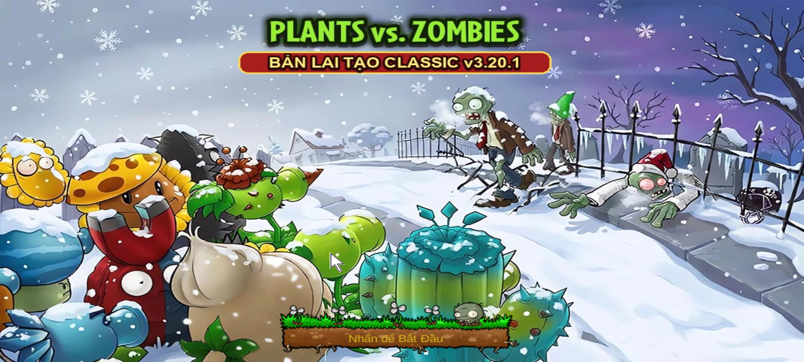

  

  
  
  
  
  

  &nbsp;&nbsp;
  &nbsp;&nbsp;
  

  🌐 <b>Đổi ngôn ngữ trang / 切换页面语言:</b> Bấm <b><a href="README.vi.md">[VI] Bản Việt Hóa</a></b> để xem Tiếng Việt • 点击 <b><a href="README.cn.md">[CN] 简体中文</a></b> 查看中文说明

  <a href="#downloads"><b>📥 Downloads</b></a> &nbsp;•&nbsp;
  <a href="#install"><b>🔄 Install &amp; Switch Language</b></a> &nbsp;•&nbsp;
  <a href="#highlights"><b>✨ Highlights</b></a> &nbsp;•&nbsp;
  <a href="#screenshots"><b>📸 Screenshots</b></a> &nbsp;•&nbsp;
  <a href="#guides"><b>📚 Guides &amp; FAQ</b></a> &nbsp;•&nbsp;
  <a href="#credits"><b>👥 Credits</b></a>

---

## 📥 APK Downloads — `v3.20.1` (Build `B.0.2` · Latest)

> [!TIP]
> **100% Save-Preserving Versioned APKs (`B.x.y`):** Every build has its own dedicated GitHub Release and filename (`PvZ-Hybrid-Classic-3.20.1-<Lang>-B.x.y.apk`) so you can always tell new builds from old builds, trace every fix, or roll back cleanly. All editions (**`[EN]`**, **`[VI]`**, **`[CN]`**) share package ID `com.pvzh.cls` and the unified **Release Keystore** — simply **install over your existing app (Update, never uninstall)** to upgrade, switch languages, or roll back with 100% save preservation!

Full release notes & fixes: **[GitHub Release `v3.20.1-B.0.2`](https://github.com/Heagon/pvz-hybrid-classic-android/releases/tag/v3.20.1-B.0.2)** · Build history & rollback archive: **[`CHANGELOG.md`](CHANGELOG.md)** ([Previous `v3.20.1-B.0.1`](https://github.com/Heagon/pvz-hybrid-classic-android/releases/tag/v3.20.1-B.0.1))

| Edition | Size | Summary | Direct Download |
| :--- | :---: | :--- | :---: |
| **`[EN]` English (`B.0.2`)** | `387.72 MiB` (`406.6 MB`) | Complete English build (3,309 property strings + 437 refitted Almanac entries, 1,038 EXE strings / 1,421 refs, 171 localized UI textures, **live `30/60/90/120 FPS` selector + `50.5–89.2 FPS` non-combat + `OPT 8–13` + `PAD` toolbar + 1-tap Menu / I-Zombie / ViewLawn / Hero / LAA fixes**) |  |
| **`[VI]` Bản Việt Hóa (`B.0.2`)** | `387.88 MiB` (`406.7 MB`) | Complete accented Vietnamese build (3,309 property strings + 437 refitted Almanac entries, 1,038 EXE strings / 1,421 refs, 171 VI textures, 6 merged Unicode `.ttf` fonts, **live `30/60/90/120 FPS` selector + `50.5–89.2 FPS` non-combat + `OPT 8–13` + `PAD` toolbar + all fixes**) |  |
| **`[CN]` 中文原版 (`B.0.2`)** | `389.47 MiB` (`408.4 MB`) | Original Chinese v3.20.1 by **[潜艇伟伟迷](https://space.bilibili.com/97213827)**, bundled standalone with **live `30/60/90/120 FPS` + `OPT 8–13` + `PAD` toolbar + all crash/gameplay fixes** and signed with the unified keystore |  |

<b>🔐 APK Verification &amp; SHA-256 Checksums (`v3.20.1-B.0.2`)</b>

- **Package Name:** `com.pvzh.cls` · **Version:** `3.20.1` (`versionCode: 3201`) · **Build ID:** `B.0.2`
- **Signing Certificate SHA-256:** `0240760843400889e49e0030ea741eace8e6e97d64b47c560d609438943339f2`

| File | Exact Bytes | SHA-256 |
| :--- | :---: | :--- |
| `PvZ-Hybrid-Classic-3.20.1-English-B.0.2.apk` | `406,554,840` | `c299cf884bc665fa244455c9a01ea029f237676f8f5b08c80be987d80b0f8098` |
| `PvZ-Hybrid-Classic-3.20.1-Vietnamese-B.0.2.apk` | `406,718,680` | `f3c00fc4db478ce06c3872cc30ca0b910d5dbf16b53966b030da6aef1c0cedb5` |
| `PvZ-Hybrid-Classic-3.20.1-Chinese-Raw-B.0.2.apk` | `408,393,944` | `799db80d71d0441073a26cc3a8da03accb87332a6f41e1d9cc70b15b079f110e` |

---

## 🔄 3-Step Installation &amp; Language Switching

1. **Download APK:** Grab **`[EN]`**, **`[VI]`**, or **`[CN]`** from the table above on any **Android 8.0+ (`arm64-v8a`)** device with ~1.8 GB free space.
2. **Install / Update in Place:** Open the APK and tap **Install** (or **Update** when switching between `[EN]` / `[VI]` / `[CN]` — **never uninstall**).
3. **Wait ~20–45s on First Launch &amp; Play:** `PvZBootstrapActivity` automatically unpacks the embedded runtime and game payload, seeds a default `"Player"` profile, and launches *PvZ Hybrid Classic v3.20.1* fullscreen!

### 📚 Guides, Tooling &amp; Documentation

| Guide | What It Covers |
| :--- | :--- |
| 📖 **[Installation &amp; Troubleshooting (`docs/INSTALL.md`)](docs/INSTALL.md)** | System requirements, Play Protect notice, touch &amp; Back-button virtual keyboard (`WASD`/`Space`), and graphics tips. |
| 🔄 **[Safe Updates, Rollback &amp; Language Switching (`docs/UPDATE.md`)](docs/UPDATE.md)** | Why `pvz_edition.txt` (`B.x.y`) swaps `pvz_game/` cleanly on upgrades, rollbacks, and language switches while keeping `yourdata/` saves 100% untouched. |
| 📋 **[Build History &amp; Release Changelog (`CHANGELOG.md`)](CHANGELOG.md)** | Complete timeline of every `B.x.y` release (`B.0.1`, `B.0.2`, ...), exact fixes per build, and rollback links. |
| 💾 **[PC Save Backup &amp; Migration (`docs/MIGRATION.md`)](docs/MIGRATION.md)** | Step-by-step guide to copy Windows PC saves (`C:\ProgramData\PopCap Games\PlantsVsZombies\pvzHE\yourdata\`) into Android without root. |
| 🛠️ **[Build &amp; Patch Pipeline (`tools/README.md`)](tools/README.md)** | Open-source Python &amp; C/ASM scripts (`gdi42.dll` UTF-8 + Glyph Atlas, `OPT 1–13`, gameplay/crash fixes, EXE relocation, texture localization, `.tzst` &amp; APK packaging). |
| 👥 **[Complete Credits &amp; Official Sources (`CREDITS.md`)](CREDITS.md#en-english)** | Full attribution honoring the original creator (**潜艇伟伟迷**), contributors, EA/PopCap, and open-source tools. |

---

## ✨ Technical Highlights (`B.0.2`)

*Plants vs. Zombies: Hybrid Classic* (*植物大战僵尸杂交版经典版*) was built as a Windows PopCap C++ binary mod, so it normally requires manual Winlator setup on mobile and only renders GBK Chinese text. This suite packages everything into one standalone Android app:

- **Zero Emulator Hassle, Floating `PAD` Controls &amp; Clean Shutdown:** Bundled standalone runtime (`com.pvzh.cls`) with no root, no manual container import, and no external Winlator installation required. Includes a draggable **`PAD`** toolbar (live **`30 / 60 / 90 / 120 FPS`** switcher, **Quick Hotkeys** strip, **Hero D-Pad**, **Drag**, **Opacity**, **Keyboard**, **Menu**) and cleanly tears down Wine processes on exit without auto-restarting.
- **Native `1080x600` Mobile Widescreen &amp; 1-Tap Touch:** Automatically launches in true `1080x600` widescreen edge-to-edge on phone displays (0 sidebars, 0 clipped right-side menus), fixes axis-independent `TouchpadView` coordinates, and fixes 1-tap `Menu` &amp; `Shovel` responsiveness across every mode (including `I, Zombie`).
- **Live `30 / 60 / 90 / 120 FPS` + `50.5–89.2 FPS` Non-Combat + Exact `100.00 Hz` Speed Parity (`OPT 1–13` + `gdi42` O(1) Glyph Atlas):** Powered by **`VirGL`** + **`WineD3D` GL (`csmt=0`, FBO, `VideoMemorySize=512`)**, Box64 fast dynarec, `detectBigCoreAffinity()`, `gdi42.dll` O(1) Glyph Atlas, and 13 binary engine optimizations (1-Quad Baked Seed-Card Atlas, Universal 12-Page `DrawTrianglesTex` Sprite Atlas + `3072`-vertex batcher, `HasSeedType` O(1) memo, occluded `PoolEffect` &amp; `Board::Draw` culling, zero-syscall `fps_cap.bin` pacer). Verified on **TECNO LG8n (Helio G99, 90 Hz)**: **all non-combat screens reach `50.5–89.2 FPS`** (SeedChooser all 5 Survival maps **`62.6–67.1 FPS`**), exact **`100.00 Hz` (`-10s/10.0s`)** game speed across `30 / 60 / 120 FPS`, and **`0` crashes** over continuous soak testing.
- **Gameplay &amp; Stability Fixes (`patch_exe_fixes.py` + `ViewLawn` Sync):** Fixed `ViewLawn` (`Xem Bãi Cỏ`) soft-lock, `I, Zombie` free-spawn exploit &amp; 1-tap `Menu`, long-session `LAA` (`>2 GB` heap) signed-pointer crash, 30+ Hero Mode &amp; Reanimation crash guards, Almanac O(1) LUT, and cleaned `NewOptionsDialog`.
- **Engine-Level UTF-8 &amp; Font Upgrade:** Binary-patched `gdi42.dll` (`CP936` → `CP_UTF8`) across all 4 `MultiByteToWideChar` call sites and merged complete Latin + Vietnamese diacritics via `fontTools` into all 6 runtime `.ttf` fonts.
- **Full Dual-Layer Localization &amp; UI Refit:**
  - **3,309/3,309** property strings across all 9 `properties/*.txt` files, including **437 Plant, Zombie &amp; Hero Almanac descriptions refitted** cleanly within non-scrolling card bounds.
  - **1,038 unique / 1,421 referenced** hardcoded binary strings relocated cleanly inside `PlantsVsZombies.exe` + **73 `std::string(ptr, len)` length-push opcodes updated** + Main Menu version prefix (`PvZ Hybrid Cls EN v3.20.1`).
  - **171 localized UI textures** per language (Main Menu signs, wood plaques, gravestones, 22 Adventure/Mode banners, 17 Adventure chapter book covers, 141 Space-Time / Secret Realm map nodes, Experimental Logs `01–09`, Almanac/Shop/Achievement/Hero buttons, `FlagMeter` progress, and title badges).

---

## 📸 Real Android Device Screenshots

Captured on physical `arm64-v8a` Android hardware across **`[EN]` English** and **`[VI]` Bản Việt Hóa**:

| Startup &amp; Player Rules | Main Menu (`v3.20.1-EN`) |
| :---: | :---: |
|  |  |
| **Seed Chooser &amp; Card Tabs** | **Adventure 1-1 Gameplay HUD** |
|  |  |
| **Suburban Almanac — Hybrid Plants** | **In-Game Pause &amp; Options Menu** |
|  |  |

<b>🇻🇳 Preview `[VI]` Bản Việt Hóa Screenshots (6 Screens Side-by-Side)</b>

 

| Nội Quy &amp; Khởi Động (`[VI]`) | Menu Chính (`v3.20.1-VI`) |
| :---: | :---: |
|  |  |
| **Chọn Hạt Giống (`[VI]`)** | **Chiến Đấu Sân Trước 1-1 (`[VI]`)** |
|  |  |
| **Sổ Tay Thực Vật Lai (`[VI]`)** | **Menu Tạm Dừng &amp; Cài Đặt (`[VI]`)** |
|  |  |

> 👉 Switch to **[`[VI]` Bản Việt Hóa (`README.vi.md`)](README.vi.md)** for full Vietnamese documentation.

---

## 👥 Credits &amp; Official Sources

Full official attribution page: **[`CREDITS.md`](CREDITS.md#en-english)**

| Category / Role | Creators &amp; Contributors | Official Links |
| :--- | :--- | :--- |
| **Original Mod** *PvZ Hybrid Classic* (植物大战僵尸杂交版经典版) | • **Qianting Weiweimi (潜艇伟伟迷)** — Creator, Game Design &amp; Lead Developer • **In-Game Credited Contributors:** 小小咩MS, AXH弦, 一只吴铭仕哒, 沉默寡言白河愁 | [Official Bilibili](https://space.bilibili.com/97213827) · [Official Website (`pvzhe.com`)](https://pvzhe.com) |
| **Original Game Franchise** | • **Electronic Arts Inc. (EA) / PopCap Games** — Original *Plants vs. Zombies* | [CREDITS.md](CREDITS.md#en-english) |
| **Localization (`[EN]` / `[VI]`), Engine Optimization &amp; Android Packaging** | • **Heagon** — 3,309 property strings + 1,038 EXE strings (1,421 refs), 171 localized UI textures/lang, `gdi42.dll` UTF-8 + O(1) Glyph Atlas, 6 merged Unicode fonts, `OPT 1–13` (`30/60/90/120 FPS` + `100 Hz` parity), gameplay/crash fixes, `PAD` toolbar &amp; standalone `com.pvzh.cls` packaging | [GitHub Repository](https://github.com/Heagon/pvz-hybrid-classic-android) |
| **Open-Source Tooling** | [Winlator](https://github.com/brunodev85/winlator) (`Box64` · `Wine`), [MinGW-w64 / w64devkit](https://github.com/skeeto/w64devkit), [fontTools](https://github.com/fonttools/fonttools), [Pillow](https://python-pillow.org/), [Liberation Fonts](https://github.com/liberationfonts/liberation-fonts), [Apktool](https://apktool.org/), [uber-apk-signer](https://github.com/patrickfav/uber-apk-signer), [Zstandard](https://github.com/facebook/zstd) | See [CREDITS.md](CREDITS.md#en-english) |

---

## ⚖️ Non-Commercial Disclaimer

- *Plants vs. Zombies* is a registered trademark of **Electronic Arts Inc. (EA) / PopCap Games**.
- All rights to *Plants vs. Zombies: Hybrid Classic* belong to **潜艇伟伟迷** and contributors.
- This repository is a **100% free, non-commercial, ad-free fan localization project** distributed as-is for community accessibility. Never pay third parties or resellers for this release.
