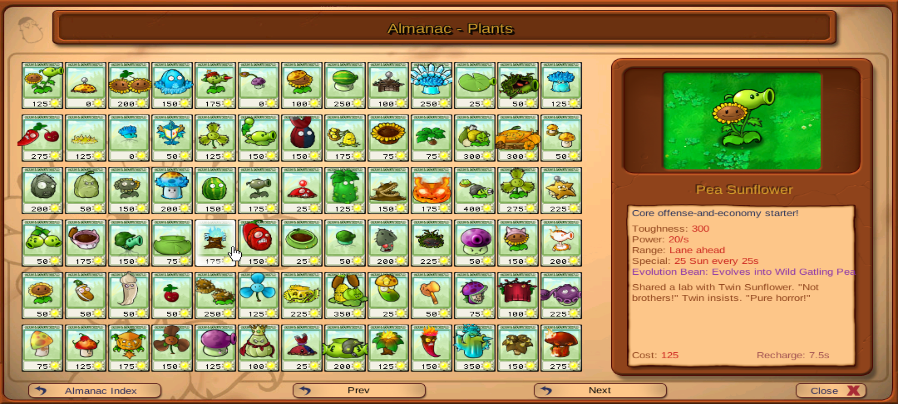
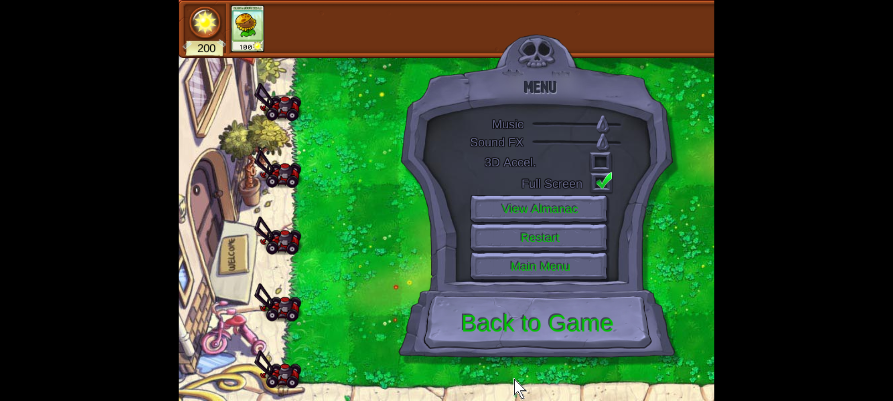
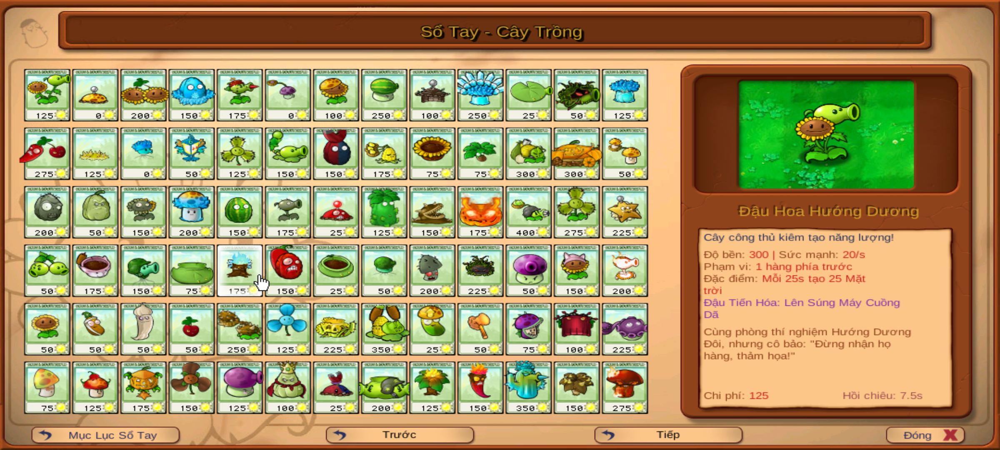

  

  
  
  
  

  &nbsp;&nbsp;
  &nbsp;&nbsp;
  

  🌐 <b>Đổi ngôn ngữ trang / 切换页面语言:</b> Bấm <b><a href="README.vi.md">[VI] Bản Việt Hóa</a></b> để xem Tiếng Việt • 点击 <b><a href="README.cn.md">[CN] 简体中文</a></b> 查看中文说明

  <a href="#downloads"><b>📥 Downloads</b></a> &nbsp;•&nbsp;
  <a href="#install"><b>🔄 Install &amp; Switch Language</b></a> &nbsp;•&nbsp;
  <a href="#highlights"><b>✨ Highlights</b></a> &nbsp;•&nbsp;
  <a href="#screenshots"><b>📸 Screenshots</b></a> &nbsp;•&nbsp;
  <a href="#guides"><b>📚 Guides &amp; FAQ</b></a> &nbsp;•&nbsp;
  <a href="#credits"><b>👥 Credits</b></a>

---

## 📥 APK Downloads — `v3.20.1`

> [!TIP]
> **100% Save-Preserving Standalone APKs:** All three editions (**`[EN] English`**, **`[VI] Bản Việt Hóa`**, and **`[CN] Chinese Raw`**) share package ID `com.pvzh.cls` and the unified **Release Keystore**. No separate emulator, external OBB, or container import needed — just **install directly over your existing app (Update, never uninstall)** to switch languages anytime with 100% of your progress intact!

Full release notes & checksums: **[GitHub Release `v3.20.1`](https://github.com/Heagon/pvz-hybrid-classic-android/releases/tag/v3.20.1)**

| Edition | Size | Summary | Direct Download |
| :--- | :---: | :--- | :---: |
| **`[EN]` English** | `387.7 MiB` (`406.5 MB`) | Complete English build (3,309 property strings with 437 refitted Almanac descriptions, 1,038 unique EXE strings / 1,421 binary refs, 171 localized UI textures, **`~29–34 FPS` performance optimization + `VirGL` + big-core affinity**, hardware-verified on Android) |  |
| **`[VI]` Bản Việt Hóa** | `387.8 MiB` (`406.7 MB`) | Complete accented Vietnamese build (3,309 property strings with 437 refitted Almanac descriptions, 1,038 unique EXE strings / 1,421 binary refs, 171 localized VI UI textures, 6 merged Unicode `.ttf` fonts, **`~29–34 FPS` performance optimization + `VirGL`**) |  |
| **`[CN]` 中文原版 (Raw)** | `389.4 MiB` (`408.4 MB`) | Original Chinese v3.20.1 by **潜艇伟伟迷**, bundled standalone with **`~29–34 FPS` binary performance optimization + `VirGL`** and signed with the unified keystore for lossless switching |  |

<b>🔐 APK Verification &amp; SHA-256 Checksums</b>

- **Package Name:** `com.pvzh.cls` · **Version:** `3.20.1` (`versionCode: 3201`)
- **Signing Certificate SHA-256:** `0240760843400889e49e0030ea741eace8e6e97d64b47c560d609438943339f2`

| File | Exact Bytes | SHA-256 |
| :--- | :---: | :--- |
| `PvZ-Hybrid-Classic-3.20.1-English.apk` | `406,526,168` | `17cedd5b7f3d4e31de92baff658d6a9f3c79c7f1caac4d2c9cfa79ca2283096f` |
| `PvZ-Hybrid-Classic-3.20.1-Vietnamese.apk` | `406,690,008` | `69631d079f94d7481ecdcf35bc45e3e5bd6b35bc6b80be1ac2614465c7417f5f` |
| `PvZ-Hybrid-Classic-3.20.1-Chinese-Raw.apk` | `408,361,176` | `618e42b5864da5d490a6f124e7b7df81071e22cc5c6e2e8e536c521cd25627cd` |

---

## 🔄 3-Step Installation &amp; Language Switching

1. **Download APK:** Grab **`[EN]`**, **`[VI]`**, or **`[CN]`** from the table above on any **Android 8.0+ (`arm64-v8a`)** device with ~1.8 GB free space.
2. **Install / Update in Place:** Open the APK and tap **Install** (or **Update** when switching between `[EN]` / `[VI]` / `[CN]` — **never uninstall**).
3. **Wait ~20–45s on First Launch &amp; Play:** `PvZBootstrapActivity` automatically unpacks the embedded runtime and game payload, seeds a default `"Player"` profile, and launches *PvZ Hybrid Classic v3.20.1* fullscreen!

### 📚 Guides, Tooling &amp; Documentation

| Guide | What It Covers |
| :--- | :--- |
| 📖 **[Installation &amp; Troubleshooting (`docs/INSTALL.md`)](docs/INSTALL.md)** | System requirements, Play Protect notice, touch &amp; Back-button virtual keyboard (`WASD`/`Space`), and graphics tips. |
| 🔄 **[Safe Updates &amp; Language Switching (`docs/UPDATE.md`)](docs/UPDATE.md)** | Why `pvz_edition.txt` swaps `pvz_game/` cleanly on in-place updates while keeping `yourdata/` saves 100% untouched. |
| 💾 **[PC Save Backup &amp; Migration (`docs/MIGRATION.md`)](docs/MIGRATION.md)** | Step-by-step guide to copy Windows PC saves (`C:\ProgramData\PopCap Games\PlantsVsZombies\pvzHE\yourdata\`) into Android without root. |
| 🛠️ **[Build &amp; Patch Pipeline (`tools/README.md`)](tools/README.md)** | Open-source Python scripts (`gdi42.dll` UTF-8 shim, EXE string relocation, texture localization, `.tzst` &amp; APK packaging). |
| 👥 **[Complete Credits (`CREDITS.md`)](CREDITS.md)** | Full attribution honoring the original creator, contributors, and open-source tools. |

---

## ✨ Technical Highlights

*Plants vs. Zombies: Hybrid Classic* (*植物大战僵尸杂交版经典版*) was built as a Windows PopCap C++ binary mod, so it normally requires manual Winlator setup on mobile and only renders GBK Chinese text. This suite packages everything into one standalone Android app:

- **Zero Emulator Hassle:** Bundled standalone runtime (`com.pvzh.cls`) with no root, no manual container import, and no external Winlator installation required.
- **Native `1080x600` Mobile Widescreen &amp; 1-Tap Touch:** Automatically launches in true `1080x600` widescreen stretched edge-to-edge on phone displays (0 sidebars, 0 clipped right-side menus), fixes axis-independent `TouchpadView` coordinates, and injects `ACTION_DOWN` cursor tracking + 60 ms hold with `HUDMode=0` clean fullscreen gameplay.
- **Smooth ~30 FPS Engine &amp; Android Performance Tuning (`VirGL` + Dynamic Big-Core Affinity):** Defaults to **`VirGL`** + **`WineD3D` GL (`csmt=0`, `OffscreenRenderingMode=fbo`, `strict_shader_math=0`, `VideoMemorySize=512`)**, `WINEESYNC=1`, `mesa_glthread=false`, upright `Is3D=1` 3D Acceleration, Box64 fast dynarec (`STRONGMEM=0`, `BIGBLOCK=3`, `CALLRET=1`, `FASTNAN=1`, `FASTROUND=1`, `NATIVEFLAGS=1`, `FORWARD=1024`), and dynamic per-SoC big/performance-core scheduling (`detectBigCoreAffinity()`). Combined with 5 binary `.newHE` optimizations (`patch_exe_perf.py`: `30 FPS` render pacing decoupled from `100 Hz` game logic, off-screen `SeedChooser` card culling jumping from `3.35 FPS` to `9.8–11.7 FPS`, zero-angle `Reanimation::MatrixFromTransform` fast path, particle-spawn throttling under heavy load, and snappy `4–20x` faster camera/menu transitions with `SeedBank` safety), reaching **`28.5–29.1 FPS`** on menus and **`33.9–34.0 FPS`** in Adventure `1-1` (`~20–27 FPS` in heavy Challenge modes) on mid-range Helio G99 Android hardware.
- **Engine-Level UTF-8 &amp; Font Upgrade:** Binary-patched `gdi42.dll` (`CP936` → `CP_UTF8`) across all 4 `MultiByteToWideChar` call sites and merged complete Latin + Vietnamese diacritics via `fontTools` into all 6 runtime `.ttf` fonts.
- **Full Dual-Layer Localization &amp; UI Refit:**
  - **3,309/3,309** property strings across all 9 `properties/*.txt` files, including **437 Plant, Zombie &amp; Hero Almanac descriptions refitted** cleanly within non-scrolling card bounds, compact Seed Chooser tabs (`Gem`/`K.C`, `7-Clr`/`7 Màu`), and tight `Get:`/`Quà:` Achievement rewards.
  - **1,038 unique / 1,421 referenced** hardcoded binary strings relocated cleanly inside `PlantsVsZombies.exe` (covering Console options, Sandbox, Shop, Stage titles, and dialogs, plus non-overlapping `ContinueDialog` button rects &amp; expanded Almanac text boxes) + **73 `std::string(ptr, len)` length-push opcodes updated** + Main Menu version prefix (`PvZ Hybrid Cls EN v3.20.1`).
  - **171 localized UI textures** per language (Main Menu signs, wood plaques, gravestones, 22 Adventure/Mode banners, 17 Adventure chapter book covers, 141 Space-Time / Secret Realm map nodes on `HybridTime_BG.png` / `HybridTime_BG2.png`, Experimental Logs `01–09`, Almanac/Shop/Achievement/Hero buttons, `FlagMeter` progress, and title badges).

---

## 📸 Real Android Device Screenshots

Captured on physical `arm64-v8a` Android hardware across **`[EN]` English** and **`[VI]` Bản Việt Hóa**:

| Startup &amp; Player Rules | Main Menu (`v3.20.1-EN`) |
| :---: | :---: |
|  |  |
| **Seed Chooser &amp; Card Tabs** | **Adventure 1-1 Gameplay HUD** |
|  |  |
| **Suburban Almanac — Hybrid Plants** | **In-Game Pause &amp; Options Menu** |
|  |  |

<b>🇻🇳 Preview `[VI]` Bản Việt Hóa Screenshots (6 Screens Side-by-Side)</b>

 

| Nội Quy &amp; Khởi Động (`[VI]`) | Menu Chính (`v3.20.1-VI`) |
| :---: | :---: |
|  |  |
| **Chọn Hạt Giống (`[VI]`)** | **Chiến Đấu Sân Trước 1-1 (`[VI]`)** |
|  |  |
| **Sổ Tay Thực Vật Lai (`[VI]`)** | **Menu Tạm Dừng &amp; Cài Đặt (`[VI]`)** |
|  |  |

> 👉 Switch to **[`[VI]` Bản Việt Hóa (`README.vi.md`)](README.vi.md)** for full Vietnamese documentation.

---

## 👥 Credits &amp; Acknowledgements

| Category / Role | Creators &amp; Contributors | Official Links |
| :--- | :--- | :--- |
| **Original Mod** *PvZ Hybrid Classic* (植物大战僵尸杂交版经典版) | • **Qianting Weiweimi (潜艇伟伟迷)** — Creator, Game Design &amp; Lead Developer • **In-Game Credited Contributors:** 小小咩MS, AXH弦, 一只吴铭仕哒, 沉默寡言白河愁 | *PvZ Hybrid Edition Classic v3.20.1* |
| **Localization (`[EN]` / `[VI]`), UTF-8 Engine Shim &amp; Android Packaging** | • **Heagon** — 3,309 property strings (437 refitted Almanac entries) + 1,038 unique EXE strings (1,421 refs), 171 localized UI textures/lang, `gdi42.dll` UTF-8 shim, 6 merged Unicode fonts, `VirGL` + `WineD3D` `csmt=0` tuning + `GLXExtension` upright fix, standalone `com.pvzh.cls` APK packaging | [GitHub Repository](https://github.com/Heagon/pvz-hybrid-classic-android) |
| **Open-Source Tooling** | [Winlator](https://github.com/brunodev85/winlator) (`Box64` · `Wine`), [fontTools](https://github.com/fonttools/fonttools), [Pillow](https://python-pillow.org/), [Liberation Fonts](https://github.com/liberationfonts/liberation-fonts), [Apktool](https://apktool.org/), [uber-apk-signer](https://github.com/patrickfav/uber-apk-signer), [Zstandard](https://github.com/facebook/zstd) | See [CREDITS.md](CREDITS.md) |

---

## ⚖️ Non-Commercial Disclaimer

- *Plants vs. Zombies* is a registered trademark of **Electronic Arts Inc. (EA) / PopCap Games**.
- All rights to *Plants vs. Zombies: Hybrid Classic* belong to **潜艇伟伟迷** and contributors.
- This repository is a **100% free, non-commercial, ad-free fan localization project** distributed as-is for community accessibility. Never pay third parties or resellers for this release.
