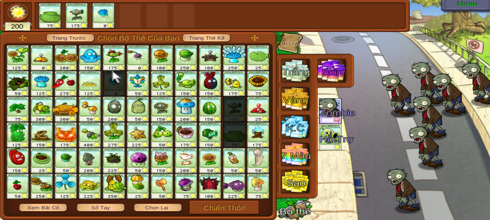
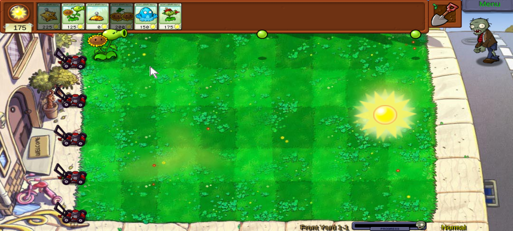

  

  
  
  
  

  &nbsp;&nbsp;
  &nbsp;&nbsp;
  

  🌐 <b>Switch Language / 切换语言:</b> Click <b><a href="README.md">[EN] English</a></b> for English • 点击 <b><a href="README.cn.md">[CN] 简体中文</a></b> 查看中文说明

  <a href="#downloads"><b>📥 Tải Game</b></a> &nbsp;•&nbsp;
  <a href="#install"><b>🔄 Cài Đặt &amp; Đổi Ngôn Ngữ</b></a> &nbsp;•&nbsp;
  <a href="#highlights"><b>✨ Điểm Nổi Bật</b></a> &nbsp;•&nbsp;
  <a href="#screenshots"><b>📸 Ảnh Thực Tế</b></a> &nbsp;•&nbsp;
  <a href="#guides"><b>📚 Hướng Dẫn &amp; Sửa Lỗi</b></a> &nbsp;•&nbsp;
  <a href="#credits"><b>👥 Đội Ngũ (Credits)</b></a>

---

## 📥 Tải Về Bộ Cài APK Độc Lập — `v3.20.1`

> [!TIP]
> **1 Tệp APK Duy Nhất · Giữ Save 100%:** Cả 3 phiên bản (**`[VI] Bản Việt Hóa`**, **`[EN] English`**, **`[CN] Trung Gốc`**) đều là APK chạy thẳng không cần cài Winlator rời hay tải container thủ công, dùng chung mã gói `com.pvzh.cls` và cùng **Release Keystore**. Khi đổi ngôn ngữ hoặc cập nhật, chỉ cần **Cài đặt đè / Cập nhật (Update)** — **tuyệt đối không gỡ bản cũ** — là giữ nguyên 100% file save!

Chi tiết bản phát hành & mã kiểm tra SHA-256: **[GitHub Release `v3.20.1`](https://github.com/Heagon/pvz-hybrid-classic-android/releases/tag/v3.20.1)**

| Phiên bản ngôn ngữ | Dung lượng | Tóm tắt nội dung | Tải trực tiếp |
| :--- | :---: | :--- | :---: |
| **`[VI]` Bản Việt Hóa** | `387.8 MiB` (`406.7 MB`) | Việt hóa hoàn chỉnh (3.309 chuỗi `properties` kèm 437 mô tả Sổ Tay tinh gọn vừa khung, 1.038 chuỗi EXE / 1.421 tham chiếu, 171 texture Việt hóa, 6 font Unicode, **tối ưu hiệu năng `~29–34 FPS` + `VirGL` + tự dò lõi hiệu năng cao**) |  |
| **`[EN]` English** | `387.7 MiB` (`406.5 MB`) | Bản Tiếng Anh hoàn chỉnh (3.309 chuỗi `properties` kèm 437 mô tả Sổ Tay tinh gọn, 1.038 chuỗi EXE / 1.421 tham chiếu, 171 texture Tiếng Anh, **tối ưu hiệu năng `~29–34 FPS` + `VirGL`**, cài đè từ `[VI]` giữ nguyên 100% save) |  |
| **`[CN]` 中文原版 (Trung Gốc)** | `389.4 MiB` (`408.4 MB`) | Bản gốc tiếng Trung v3.20.1 của tác giả **潜艇伟伟迷**, tích hợp sẵn **tối ưu hiệu năng nhị phân `~29–34 FPS` + `VirGL`** và ký chung keystore để cài đè qua lại không mất tiến trình |  |

<b>🔐 Kiểm Tra Tính Toàn Vẹn &amp; Mã SHA-256 Chính Thức</b>

- **Tên gói:** `com.pvzh.cls` · **Phiên bản:** `3.20.1` (`versionCode: 3201`)
- **Chữ ký số chung (Cert SHA-256):** `0240760843400889e49e0030ea741eace8e6e97d64b47c560d609438943339f2`

| Tên tệp APK | Kích thước chuẩn (Bytes) | SHA-256 |
| :--- | :---: | :--- |
| `PvZ-Hybrid-Classic-3.20.1-Vietnamese.apk` | `406,690,009` | `90dc97ef7628b663910812e77f0312b3f8326ffcae663e5569feb481ef5b3baa` |
| `PvZ-Hybrid-Classic-3.20.1-English.apk` | `406,526,169` | `98b0aaef91e536b65986c03aaeb10d0cde52b0bc4da35720c135a1d318efc1c9` |
| `PvZ-Hybrid-Classic-3.20.1-Chinese-Raw.apk` | `408,361,177` | `63f9556e36c57fa2d44641aa5579b67166bf240fe8fcecac63cb79eb306b2b72` |

---

## 🔄 Hướng Dẫn Cài Đặt &amp; Đổi Ngôn Ngữ Trong 3 Bước

1. **Tải tệp APK:** Chọn **`[VI]`**, **`[EN]`** hoặc **`[CN]`** ở bảng trên (yêu cầu **Android 8.0+**, `arm64-v8a`, bộ nhớ trống ~1.8 GB).
2. **Cài Đặt / Cài Đè Trực Tiếp:** Mở file APK vừa tải và bấm **Cài đặt** (hoặc **Cập nhật** khi muốn đổi ngôn ngữ — **không gỡ bản cũ**).
3. **Chờ Giải Nén Lần Đầu (~20–45 giây) &amp; Chơi:** `PvZBootstrapActivity` sẽ tự giải nén môi trường chạy và dữ liệu game, tạo sẵn hồ sơ `Player`, rồi tự động mở toàn màn hình *PvZ Hybrid Classic v3.20.1*!

### 📚 Thư Viện Hướng Dẫn &amp; Sửa Lỗi

| Tài liệu chi tiết | Nội dung bên trong |
| :--- | :--- |
| 📖 **[Hướng Dẫn Cài Đặt &amp; Sửa Lỗi (`docs/INSTALL.md`)](docs/INSTALL.md#vi-bản-việt-hóa)** | Yêu cầu máy, xử lý nhắc nhở Play Protect, cách mở bàn phím ảo `WASD`/`Space` bằng nút Back và tùy chỉnh đồ họa. |
| 🔄 **[Cập Nhật Không Mất Save (`docs/UPDATE.md`)](docs/UPDATE.md#vi-bản-việt-hóa)** | Cơ chế tem `pvz_edition.txt` chỉ thay mới thư mục `pvz_game/` và giữ nguyên 100% file save `yourdata/`. |
| 💾 **[Chuyển File Save Từ PC Sang APK (`docs/MIGRATION.md`)](docs/MIGRATION.md#vi-bản-việt-hóa)** | Cách chép `C:\ProgramData\PopCap Games\PlantsVsZombies\pvzHE\yourdata\` từ Windows PC vào điện thoại không cần Root. |
| 🛠️ **[Mã Nguồn Script Đóng Gói (`tools/README.md`)](tools/README.md)** | Công khai toàn bộ quy trình Python (`gdi42.dll` UTF-8, vá EXE, vẽ texture, nén `.tzst`, ký APK). |
| 👥 **[Danh Sách Đội Ngũ (`CREDITS.md`)](CREDITS.md#vi-bản-việt-hóa)** | Tri ân tác giả game gốc, đội ngũ đóng góp và các thư viện mã nguồn mở. |

---

## ✨ Điểm Nổi Bật Kỹ Thuật

Khác với *PvZ Fusion* (làm trên Unity), *PvZ Hybrid Classic* (*植物大战僵尸杂交版经典版*) được lập trình bằng C++ PopCap cho Windows với mã hóa chữ GBK. Dự án này xử lý triệt để mọi rào cản để biến game thành **1 tệp APK dùng ngay trên Android**:

- **Không Cần Thiết Lập Giả Lập &amp; Thoát Game Sạch Sẽ:** Tích hợp sẵn Wine/Box64 bên trong gói riêng `com.pvzh.cls`, cài là chơi, không xung đột với các bản Winlator hay PvZ khác; khi bấm Thoát trong game hoặc Exit ở menu Drawer sẽ đóng sạch tiến trình Wine/task Android thay vì tự khởi động lại.
- **Khung Hình Widescreen `1080x600` Tràn Viền &amp; Cảm Ứng 1-Chạm:** Tự động cấu hình chuẩn rộng `1080x600` kéo đầy màn hình điện thoại (không viền đen, không mất nút góc phải), ẩn HUD mặc định (`HUDMode=0`), sửa ánh xạ X/Y độc lập trong `TouchpadView` và di chuyển con trỏ ngay khi chạm `ACTION_DOWN` (giữ click 60 ms) giúp chạm nút 1 lần ăn ngay.
- **Tối Ưu Ổn Định `~29–34 FPS` &amp; Giảm Chuyển Cảnh Chậm (`VirGL` + Ghim Lõi Hiệu Năng Cao):** Mặc định dùng **`VirGL`** kết hợp **`WineD3D` GL (`csmt=0`, `OffscreenRenderingMode=fbo`, `strict_shader_math=0`, `VideoMemorySize=512`)**, `WINEESYNC=1`, tắt `mesa_glthread`, bật `Is3D=1` sắc nét, Box64 fast dynarec (`STRONGMEM=0`, `BIGBLOCK=3`, `CALLRET=1`, `FASTNAN=1`, `FASTROUND=1`, `NATIVEFLAGS=1`, `FORWARD=1024`), và tự dò lõi CPU mạnh theo từng máy (`detectBigCoreAffinity()`). Kết hợp 5 cụm tối ưu nhị phân trong `.newHE` (`patch_exe_perf.py`: tách nhịp render `30 FPS` mà vẫn giữ logic game `100 Hz`, loại bỏ vẽ thẻ ngoài khung hình ở màn Chọn Cây nâng từ `3,35 FPS` lên `9,8–11,7 FPS`, fast-path `Reanimation::MatrixFromTransform` khi góc = 0, tiết chế hạt nặng khi đông particle, rút ngắn chuyển cảnh `4–20x` kèm failsafe `SeedBank`) — đạt thực tế **`28,5–29,1 FPS`** ở Menu Chính, **`33,9–34,0 FPS`** ở Phiêu Lưu `1-1` và **`~20–27 FPS`** ở các màn Thử Thách đông quái trên chip Helio G99.
- **Vá UTF-8 Tận Lõi Engine + 6 Font Unicode:** Chỉnh sửa `gdi42.dll` tại 4 điểm `MultiByteToWideChar` (`CP936` → `CP_UTF8`) và nhúng trọn vẹn bộ dấu tiếng Việt vào tất cả 6 font `.ttf` của game.
- **Bản Địa Hóa Toàn Diện &amp; Tinh Gọn Vừa Khung:**
  - **3.309/3.309** chuỗi trong 9 tệp `properties/*.txt` — đã tinh gọn toàn bộ **437 mô tả Cây Trồng, Zombie &amp; Tướng** hiển thị vừa khít khung Sổ Tay không cần cuộn, nút chọn thẻ gọn (`K.C`, `7 Màu`), và dòng thưởng Thành Tựu (`Quà:`) tách rõ khỏi bộ đếm (`Hiện tại:`).
  - **1.038 chuỗi duy nhất / 1.421 vị trí tham chiếu** trong `PlantsVsZombies.exe` (đủ 24 tùy chọn Điều Khiển, Sandbox, Cửa Hàng, tên ải, hộp thoại, kèm sửa chồng chéo nút `Tiếp tục`/`Chơi mới` và mở rộng khung chữ Sổ Tay), vá đồng bộ **73 lệnh đẩy độ dài chuỗi (`6a <len>`)** + sửa dòng phiên bản Menu Chính (`PvZ Hybrid Cls VI v3.20.1`).
  - **171 ảnh giao diện** cho mỗi ngôn ngữ (bảng gỗ Menu Chính, bia đá Chế Độ, 22 bảng tên Chương/Chế độ, 17 bìa sách Chương Phiêu Lưu, 141 thẻ bản đồ Thời Không/Bí Cảnh trên `HybridTime_BG.png`/`BG2.png`, Nhật Ký Thử Nghiệm `01–09`, Sổ Tay, Thành Tựu, thanh tiến độ `TIẾN ĐỘ`, Cửa Hàng &amp; Anh Hùng).

---

## 📸 Hình Ảnh Thực Tế Trên Thiết Bị Android (`TECNO` arm64)

| Nội Quy &amp; Khởi Động | Menu Chính (`v3.20.1-VI`) |
| :---: | :---: |
|  |  |
| **Chọn Hạt Giống &amp; Thẻ Cây** | **Chiến Đấu Sân Trước 1-1** |
|  |  |
| **Sổ Tay Thực Vật Lai** | **Menu Tạm Dừng &amp; Cài Đặt** |
|  |  |

<b>🇬🇧 Xem Thêm Ảnh Thực Tế Bản `[EN]` English (Chụp Sau Khi Cài Đè Trực Tiếp Từ Bản `[VI]`)</b>

 

| Startup &amp; Rules (`[EN]`) | Main Menu (`v3.20.1-EN`) |
| :---: | :---: |
|  |  |
| **Seed Chooser (`[EN]`)** | **Front Yard 1-1 (`[EN]`)** |
|  |  |
| **Plants Almanac (`[EN]`)** | **In-Game Menu (`[EN]`)** |
|  |  |

---

## 👥 Đội Ngũ Thực Hiện &amp; Tri Ân

| Hạng mục / Vai trò | Tác giả &amp; Đóng góp | Nguồn / Ghi nhận |
| :--- | :--- | :--- |
| **Tác giả Bản Mod Gốc** *PvZ Hybrid Classic* (植物大战僵尸杂交版经典版) | • **潜艇伟伟迷 (Qianting Weiweimi)** — Tác giả, Thiết kế &amp; Lập trình chính • **Thành viên được tri ân trong game gốc:** 小小咩MS, AXH弦, 一只吴铭仕哒, 沉默寡言白河愁 | *PvZ Hybrid Edition Classic v3.20.1* |
| **Việt Hóa, Anh Hóa, Vá Engine UTF-8 &amp; Đóng Gói APK** | • **Heagon** — 3.309 chuỗi `properties` (437 mô tả Sổ Tay tinh gọn vừa khung) + 1.038 chuỗi EXE (1.421 vị trí), 171 texture/ngôn ngữ, vá UTF-8 `gdi42.dll`, nhúng Unicode cho 6 font `.ttf`, tối ưu `VirGL` + `WineD3D` `csmt=0` &amp; `GLXExtension`, đóng gói APK độc lập `com.pvzh.cls` | [Kho GitHub Dự Án](https://github.com/Heagon/pvz-hybrid-classic-android) |
| **Công Cụ Mã Nguồn Mở** | [Winlator](https://github.com/brunodev85/winlator) (`Box64` · `Wine`), [fontTools](https://github.com/fonttools/fonttools), [Pillow](https://python-pillow.org/), [Liberation Fonts](https://github.com/liberationfonts/liberation-fonts), [Apktool](https://apktool.org/), [uber-apk-signer](https://github.com/patrickfav/uber-apk-signer), [Zstandard](https://github.com/facebook/zstd) | Xem [CREDITS.md](CREDITS.md#vi-bản-việt-hóa) |

---

## ⚖️ Tuyên Bố Bản Quyền &amp; Phi Lợi Nhuận

- *Plants vs. Zombies* là thương hiệu thuộc quyền sở hữu của **Electronic Arts Inc. (EA) / PopCap Games**.
- Toàn bộ bản quyền trò chơi gốc *植物大战僵尸杂交版经典版* thuộc về tác giả **潜艇伟伟迷** và các cộng sự.
- Dự án này hoàn toàn **miễn phí 100%, không quảng cáo, phi thương mại** nhằm giúp cộng đồng chơi thuận tiện trên Android. Tuyệt đối không mua bán bản mod dưới mọi hình thức.
