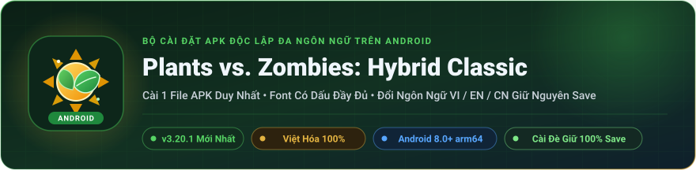

  

  
  
  
  
  

  &nbsp;&nbsp;
  &nbsp;&nbsp;
  

  🌐 <b>Switch Language / 切换语言:</b> Click <b><a href="README.md">[EN] English</a></b> for English • 点击 <b><a href="README.cn.md">[CN] 简体中文</a></b> 查看中文说明

  <a href="#downloads"><b>📥 Tải Game</b></a> &nbsp;•&nbsp;
  <a href="#install"><b>🔄 Cài Đặt &amp; Đổi Ngôn Ngữ</b></a> &nbsp;•&nbsp;
  <a href="#highlights"><b>✨ Điểm Nổi Bật</b></a> &nbsp;•&nbsp;
  <a href="#screenshots"><b>📸 Ảnh Thực Tế</b></a> &nbsp;•&nbsp;
  <a href="#guides"><b>📚 Hướng Dẫn &amp; Sửa Lỗi</b></a> &nbsp;•&nbsp;
  <a href="#credits"><b>👥 Đội Ngũ (Credits)</b></a>

---

## 📥 Tải Về Bộ Cài APK Độc Lập — `v3.20.1` (Bản Build `B.0.2` · Mới Nhất)

> [!TIP]
> **Đánh Số Bản Build `B.x.y` Rõ Ràng · Giữ Save 100%:** Mỗi lần phát hành đều có tên tệp &amp; trang GitHub Release riêng (`PvZ-Hybrid-Classic-3.20.1-<Tiếng>-B.x.y.apk`) để dễ phân biệt bản mới/cũ, xem đã sửa lỗi gì và có thể quay lại bản trước nếu cần. Cả 3 ngôn ngữ (**`[VI]`**, **`[EN]`**, **`[CN]`**) dùng chung mã gói `com.pvzh.cls` và cùng **Release Keystore** — chỉ cần **Cài đặt đè / Cập nhật (Update)**, **tuyệt đối không gỡ bản cũ**, là giữ nguyên 100% file save!

Chi tiết bản phát hành &amp; danh sách lỗi đã sửa: **[GitHub Release `v3.20.1-B.0.2`](https://github.com/Heagon/pvz-hybrid-classic-android/releases/tag/v3.20.1-B.0.2)** · Lịch sử build &amp; bản cũ: **[`CHANGELOG.md`](CHANGELOG.md)** ([Bản nền `v3.20.1-B.0.1`](https://github.com/Heagon/pvz-hybrid-classic-android/releases/tag/v3.20.1-B.0.1))

| Phiên bản ngôn ngữ | Dung lượng | Tóm tắt nội dung | Tải trực tiếp |
| :--- | :---: | :--- | :---: |
| **`[VI]` Bản Việt Hóa (`B.0.2`)** | `387.88 MiB` (`406.7 MB`) | Việt hóa hoàn chỉnh (3.309 chuỗi `properties` + 437 mô tả Sổ Tay tinh gọn, 1.038 chuỗi EXE / 1.421 tham chiếu, 171 texture VI, 6 font Unicode, **chọn nóng `30/60/90/120 FPS` + `50,5–89,2 FPS` không giao tranh + `OPT 8–13` + thanh `PAD` + vá nút Menu 1 chạm / Tôi Là Zombie / Xem Bãi Cỏ / Hero / LAA**) |  |
| **`[EN]` English (`B.0.2`)** | `387.72 MiB` (`406.6 MB`) | Bản Tiếng Anh hoàn chỉnh (3.309 chuỗi `properties` + 437 mô tả Sổ Tay tinh gọn, 1.038 chuỗi EXE / 1.421 tham chiếu, 171 texture EN, **chọn nóng `30/60/90/120 FPS` + `50,5–89,2 FPS` không giao tranh + `OPT 8–13` + thanh `PAD` + đủ bản vá**) |  |
| **`[CN]` 中文原版 (`B.0.2`)** | `389.47 MiB` (`408.4 MB`) | Bản gốc tiếng Trung v3.20.1 của tác giả **[潜艇伟伟迷](https://space.bilibili.com/97213827)**, tích hợp sẵn **chọn nóng `30/60/90/120 FPS` + `OPT 8–13` + thanh `PAD` + đủ bản vá lỗi** và ký chung keystore |  |

<b>🔐 Kiểm Tra Tính Toàn Vẹn &amp; Mã SHA-256 Chính Thức (`v3.20.1-B.0.2`)</b>

- **Tên gói:** `com.pvzh.cls` · **Phiên bản:** `3.20.1` (`versionCode: 3201`) · **Bản Build:** `B.0.2`
- **Chữ ký số chung (Cert SHA-256):** `0240760843400889e49e0030ea741eace8e6e97d64b47c560d609438943339f2`

| Tên tệp APK | Kích thước chuẩn (Bytes) | SHA-256 |
| :--- | :---: | :--- |
| `PvZ-Hybrid-Classic-3.20.1-Vietnamese-B.0.2.apk` | `406,718,680` | `f3c00fc4db478ce06c3872cc30ca0b910d5dbf16b53966b030da6aef1c0cedb5` |
| `PvZ-Hybrid-Classic-3.20.1-English-B.0.2.apk` | `406,554,840` | `c299cf884bc665fa244455c9a01ea029f237676f8f5b08c80be987d80b0f8098` |
| `PvZ-Hybrid-Classic-3.20.1-Chinese-Raw-B.0.2.apk` | `408,393,944` | `799db80d71d0441073a26cc3a8da03accb87332a6f41e1d9cc70b15b079f110e` |

---

## 🔄 Hướng Dẫn Cài Đặt &amp; Đổi Ngôn Ngữ Trong 3 Bước

1. **Tải tệp APK:** Chọn **`[VI]`**, **`[EN]`** hoặc **`[CN]`** ở bảng trên (yêu cầu **Android 8.0+**, `arm64-v8a`, bộ nhớ trống ~1.8 GB).
2. **Cài Đặt / Cài Đè Trực Tiếp:** Mở file APK vừa tải và bấm **Cài đặt** (hoặc **Cập nhật** khi muốn đổi ngôn ngữ — **không gỡ bản cũ**).
3. **Chờ Giải Nén Lần Đầu (~20–45 giây) &amp; Chơi:** `PvZBootstrapActivity` sẽ tự giải nén môi trường chạy và dữ liệu game, tạo sẵn hồ sơ `Player`, rồi tự động mở toàn màn hình *PvZ Hybrid Classic v3.20.1*!

### 📚 Thư Viện Hướng Dẫn &amp; Sửa Lỗi

| Tài liệu chi tiết | Nội dung bên trong |
| :--- | :--- |
| 📖 **[Hướng Dẫn Cài Đặt &amp; Sửa Lỗi (`docs/INSTALL.md`)](docs/INSTALL.md#vi-bản-việt-hóa)** | Yêu cầu máy, xử lý nhắc nhở Play Protect, cách mở bàn phím ảo `WASD`/`Space` và thanh `PAD`. |
| 🔄 **[Cập Nhật, Quay Lại Bản Cũ &amp; Đổi Ngôn Ngữ (`docs/UPDATE.md`)](docs/UPDATE.md#vi-bản-việt-hóa)** | Cơ chế tem `pvz_edition.txt` (`B.x.y`) chỉ thay mới `pvz_game/` và giữ nguyên 100% file save `yourdata/`. |
| 📋 **[Lịch Sử Bản Build &amp; Chi Tiết Sửa Lỗi (`CHANGELOG.md`)](CHANGELOG.md)** | Bảng đối chiếu đầy đủ mọi bản build (`B.0.1`, `B.0.2`, ...) để theo dõi sửa lỗi và quay lại bản trước. |
| 💾 **[Chuyển File Save Từ PC Sang APK (`docs/MIGRATION.md`)](docs/MIGRATION.md#vi-bản-việt-hóa)** | Cách chép `C:\ProgramData\PopCap Games\PlantsVsZombies\pvzHE\yourdata\` từ Windows PC vào điện thoại không cần Root. |
| 🛠️ **[Mã Nguồn Script Đóng Gói (`tools/README.md`)](tools/README.md)** | Công khai toàn bộ quy trình Python &amp; C/ASM (`gdi42.dll` UTF-8 + Glyph Atlas, `OPT 1–13`, vá lỗi, vẽ texture, nén `.tzst`, ký APK). |
| 👥 **[Danh Sách Đội Ngũ &amp; Nguồn Chính Thống (`CREDITS.md`)](CREDITS.md#vi-bản-việt-hóa)** | Tri ân đầy đủ tác giả gốc (**潜艇伟伟迷**), cộng sự, EA/PopCap và các công cụ mã nguồn mở. |

---

## ✨ Điểm Nổi Bật Kỹ Thuật (`B.0.2`)

Khác với *PvZ Fusion* (làm trên Unity), *PvZ Hybrid Classic* (*植物大战僵尸杂交版经典版*) được lập trình bằng C++ PopCap cho Windows với mã hóa chữ GBK. Dự án này xử lý triệt để mọi rào cản để biến game thành **1 tệp APK dùng ngay trên Android**:

- **Không Cần Giả Lập Rời, Thanh Điều Khiển `PAD` &amp; Thoát Game Sạch:** Tích hợp sẵn Wine/Box64 trong gói `com.pvzh.cls`, kèm nút nổi **`PAD`** mở nhanh **Phím tắt** (`Xẻng, Hủy R, Nhắm R, Kéo, x2, 0.25x, Dừng, Luật, Shop, Găng, HP ZB, HP Cây, Ẩn UI, Esc`), **D-Pad Anh Hùng**, **Kéo thả**, **Chọn `FPS` (`30/60/90/120`)**, **Mờ**, **Gõ phím**, **Menu**; thoát game tắt sạch không tự mở lại.
- **Khung Hình Widescreen `1080x600` &amp; Cảm Ứng 1-Chạm Chuẩn Xác:** Tự động mở rộng toàn màn hình `1080x600` (0 viền đen, không mất nút góc phải), sửa ánh xạ X/Y độc lập và khắc phục hoàn toàn lỗi bấm nút `Menu` / `Xẻng` không ăn ở mọi chế độ (kể cả `Tôi Là Zombie`).
- **Chọn Nóng `30 / 60 / 90 / 120 FPS` + Mọi Màn Không Giao Tranh `>= 30 FPS` (`50,5–89,2 FPS`) + Giữ Chuẩn Tốc Độ `100.00 Hz` (`OPT 1–13` + `gdi42` O(1) Glyph Atlas):** Kết hợp **`VirGL`** + **`WineD3D` GL (`csmt=0`, FBO, `VideoMemorySize=512`)**, Box64 fast dynarec, `detectBigCoreAffinity()`, `gdi42.dll` Glyph Atlas O(1), và 13 tối ưu nhị phân (1-Quad Baked Seed-Card Atlas, Universal 12-Page `DrawTrianglesTex` Sprite Atlas + batcher `3072` đỉnh, `HasSeedType` O(1) memo, cắt vẽ bị che `PoolEffect` &amp; `Board::Draw`, bộ giữ nhịp `fps_cap.bin` 0-syscall). Thực đo trên **TECNO LG8n (Helio G99, 90 Hz)**: **toàn bộ màn hình không giao tranh đạt `50,5–89,2 FPS`** (Chọn Cây cả 5 bản đồ Sinh Tồn đạt **`62,6–67,1 FPS`**), tốc độ game chuẩn tuyệt đối **`100.00 Hz` (`-10s/10.0s`)** ở cả `30 / 60 / 120 FPS`, chạy bền `7,9 phút` `0 crash`.
- **Vá Triệt Để Các Lỗi Gameplay &amp; Crash (`patch_exe_fixes.py` + `ViewLawn`):** Sửa kẹt mềm nút `Xem Bãi Cỏ`, sửa thả Zombie miễn phí vô hạn &amp; bấm `Menu` 1 chạm trong `Tôi Là Zombie`, vá lỗi crash `LAA` (`>2 GB` heap) khi chơi lâu/đổi nhiều chế độ, bổ sung 30+ lớp bảo vệ chống crash `Hero Mode` / `Reanimation`, tối ưu Sổ Tay O(1) và dọn gọn hộp thoại Cài Đặt.
- **Vá UTF-8 Tận Lõi Engine + 6 Font Unicode &amp; Việt Hóa Toàn Diện:** Vá `gdi42.dll` (`CP936` → `CP_UTF8`), nhúng đủ dấu tiếng Việt vào 6 font `.ttf`, biên dịch **3.309/3.309** chuỗi `properties` (437 mô tả Sổ Tay vừa khung) + **1.038 chuỗi EXE / 1.421 tham chiếu** + **171 ảnh giao diện** mỗi ngôn ngữ.

---

## 📸 Hình Ảnh Thực Tế Trên Thiết Bị Android (`TECNO` arm64)

| Nội Quy &amp; Khởi Động | Menu Chính (`v3.20.1-VI`) |
| :---: | :---: |
|  |  |
| **Chọn Hạt Giống &amp; Thẻ Cây** | **Chiến Đấu Sân Trước 1-1** |
|  |  |
| **Sổ Tay Thực Vật Lai** | **Menu Tạm Dừng &amp; Cài Đặt** |
|  |  |

<b>🇬🇧 Xem Thêm Ảnh Thực Tế Bản `[EN]` English (Chụp Sau Khi Cài Đè Trực Tiếp Từ Bản `[VI]`)</b>

 

| Startup &amp; Rules (`[EN]`) | Main Menu (`v3.20.1-EN`) |
| :---: | :---: |
|  |  |
| **Seed Chooser (`[EN]`)** | **Front Yard 1-1 (`[EN]`)** |
|  |  |
| **Plants Almanac (`[EN]`)** | **In-Game Menu (`[EN]`)** |
|  |  |

---

## 👥 Đội Ngũ Thực Hiện &amp; Nguồn Chính Thống

Trang ghi nhận bản quyền &amp; nguồn gốc đầy đủ: **[`CREDITS.md`](CREDITS.md#vi-bản-việt-hóa)**

| Hạng mục / Vai trò | Tác giả &amp; Đóng góp | Đường dẫn chính thống |
| :--- | :--- | :--- |
| **Tác giả Bản Mod Gốc** *PvZ Hybrid Classic* (植物大战僵尸杂交版经典版) | • **潜艇伟伟迷 (Qianting Weiweimi)** — Tác giả, Thiết kế &amp; Lập trình chính • **Thành viên được tri ân trong game gốc:** 小小咩MS, AXH弦, 一只吴铭仕哒, 沉默寡言白河愁 | [Kênh Bilibili Chính Thức](https://space.bilibili.com/97213827) · [Trang Chủ `pvzhe.com`](https://pvzhe.com) |
| **Thương Hiệu Trò Chơi Gốc** | • **Electronic Arts Inc. (EA) / PopCap Games** — Thương hiệu gốc *Plants vs. Zombies* | [CREDITS.md](CREDITS.md#vi-bản-việt-hóa) |
| **Việt Hóa, Anh Hóa, Tối Ưu Hiệu Năng &amp; Đóng Gói APK** | • **Heagon** — 3.309 chuỗi `properties` + 1.038 chuỗi EXE (1.421 vị trí), 171 texture/ngôn ngữ, vá UTF-8 + O(1) Glyph Atlas `gdi42.dll`, 6 font Unicode, `OPT 1–13` (`30/60/90/120 FPS` + `100 Hz`), vá lỗi gameplay/crash, thanh `PAD` &amp; đóng gói độc lập `com.pvzh.cls` | [Kho GitHub Dự Án](https://github.com/Heagon/pvz-hybrid-classic-android) |
| **Công Cụ Mã Nguồn Mở** | [Winlator](https://github.com/brunodev85/winlator) (`Box64` · `Wine`), [MinGW-w64 / w64devkit](https://github.com/skeeto/w64devkit), [fontTools](https://github.com/fonttools/fonttools), [Pillow](https://python-pillow.org/), [Liberation Fonts](https://github.com/liberationfonts/liberation-fonts), [Apktool](https://apktool.org/), [uber-apk-signer](https://github.com/patrickfav/uber-apk-signer), [Zstandard](https://github.com/facebook/zstd) | Xem [CREDITS.md](CREDITS.md#vi-bản-việt-hóa) |

---

## ⚖️ Tuyên Bố Bản Quyền &amp; Phi Lợi Nhuận

- *Plants vs. Zombies* là thương hiệu thuộc quyền sở hữu của **Electronic Arts Inc. (EA) / PopCap Games**.
- Toàn bộ bản quyền trò chơi gốc *植物大战僵尸杂交版经典版* thuộc về tác giả **潜艇伟伟迷** và các cộng sự.
- Dự án này hoàn toàn **miễn phí 100%, không quảng cáo, phi thương mại** nhằm giúp cộng đồng chơi thuận tiện trên Android. Tuyệt đối không mua bán bản mod dưới mọi hình thức.
